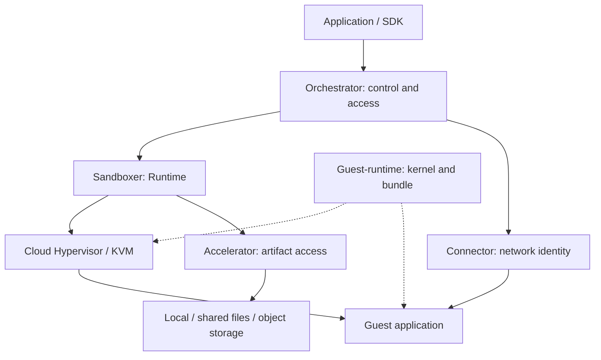

[English](architecture.md) | [简体中文](architecture_zh.md)

# System architecture, capabilities and ownership

This guide explains capability layers, runtime paths and specification ownership for platform integrators and maintainers. Read [concepts](concepts.md) for product objects and [deployment](deployment.md) for assembly.

## System paths

Solid arrows show runtime control or data relationships; dashed arrows show delivered inputs. Components can be used independently and are composed according to the deployment task.

## Capability tree and authoritative topics

| Capability family | Maintained capabilities | Authority and reading path |
| --- | --- | --- |
| Application lifecycle | Template build and ready checks; create/exec/files/ports; pause/connect/reset/delete; TTL and conditional idle pause | [Sandbox guide](sandboxes.md), [template guide](templates.md); Orchestrator lifecycle/Build/Proxy |
| Node and cluster control | Service recovery, reservation/admission, grants and watermarks; Group/provider, placement, route ownership; extensions | [Deployment](deployment.md); Orchestrator node/resource/cluster/extensions |
| Runtime execution | Runtime SDK and thin CLI, cold launch and memory restore, capture coordination, Guest and VMM boundaries | [Runtime](https://github.com/kuasar-sandbox/sandboxer/blob/main/docs/runtime.md), configuration, guest-abi and vmm |
| Runtime state | E/S logical artifacts, memory fault-in/prefetch/dirty capture, block COW/checkpoint/pin/GC, local resource execution and usage | Sandboxer artifacts/memory/block-storage/resources |
| Data access and production | Sparse references and carriers, integrity/encryption, ingest/fetch, durable Store, tiered Cache and OCI-to-EROFS production | [Accelerator](https://github.com/kuasar-sandbox/accelerator/blob/main/README.md#choose-a-complete-task-or-contract) |
| Networking | Trusted port identity, isolation and forwarding, management routes, gateway integration, TAPFD ownership | [Connector](https://github.com/kuasar-sandbox/connector/blob/main/README.md#choose-a-task) |
| Guest delivery | Runtime bundle, kernel capabilities and patches, flatten CLI, native builds and packaging | [Guest-runtime](https://github.com/kuasar-sandbox/guest-runtime/blob/main/README.md#choose-a-workflow-or-delivery-contract) |
| Operation and delivery | Logs/native usage/Telemetry metrics, diagnosis and retention; compatible upgrades; measurements, CI and aggregate releases | [Operations](operations.md), [upgrades](upgrading.md), [performance](performance.md), [CI](ci.md), [release](release.md) |

OpenTelemetry metrics service and native Collector pipelines are implemented in the
reviewed Orchestrator source; check the selected release's [observability scope](https://github.com/kuasar-sandbox/orchestrator/blob/main/docs/observability.md).
The external policy gateway is an integration boundary. Node-local lightweight
Egress remains a [proposal](https://github.com/kuasar-sandbox/connector/issues/9),
not a delivered vSwitch policy engine. Source availability does not certify that
an older aggregate contains a feature.

## Component responsibilities

| Component | System responsibility |
| --- | --- |
| `orchestrator` | `node-ctl` provides standalone E2B-compatible service, node admission and recovery; the `cluster-ctl` registry, router and placer provide the group-scoped cluster control plane |
| `sandboxer` | Drives Cloud Hypervisor and the guest, implementing MicroVM creation, execution, snapshots, restoration, destruction and the individual sandbox resource loop |
| `accelerator` | Provides local/remote references, Manifest, store, cache, OCI retrieval and EROFS flattening for images, snapshots and sparse artifacts |
| `connector` | Provides the eBPF/TC vSwitch, TAP handoff, network-resource lifecycle, sandbox isolation and foundations for external-gateway integration |
| `guest-runtime` | Builds and publishes two release units: the guest runtime image and guest kernel |

The project repository does not duplicate these implementations. It maintains system-level design, real MicroVM cross-component E2E tests, the shared execution environment and aggregate releases selecting exact version combinations.

## Dependency boundaries

Component dependencies remain explicit. At the repository level:

| Layer | Dependencies |
| --- | --- |
| T0 | accelerator, connector, guest-runtime/native-deps |
| T1 | sandboxer → accelerator, connector/pkg/tapfd |
| T2 | orchestrator → sandboxer, accelerator, connector |

Implementation stays inside its owning component, with specific packages exported across repositories. The table describes repository-level relationships, not an exhaustive package allowlist: orchestrator uses sandboxer resource and artifact/restore APIs, for example, and its MMDS source index uses connector vSwitch constants. The current module files and imports define the actual dependency set. The five components can form the complete platform or be adopted independently for particular scenarios.

## Design principles

1. **Isolation first:** each sandbox has its own guest kernel. Sharing takes place through explicit read-only layers, trusted host data paths and configured security domains.
2. **Stable user semantics:** distinguish creating a new instance from a template from resuming the same instance. An upper-level capacity-preparation policy is not another snapshot format.
3. **Selectable data paths:** local files, shared file storage and Manifest/object-storage/cache paths are all valid backends. Operators choose based on portability, scale and infrastructure.
4. **Separate control and execution:** the node controller owns admission and configured resource pools; sandboxer executes resource operations for an individual sandbox. The cluster placer owns placement, not sandbox lifecycle.
5. **Separate facts from goals:** identify implementation status, test results and design targets separately. Performance numbers require reproducible measurement definitions.
6. **Independent components:** the five component repositories can evolve, deploy and release independently. The project repository owns system design, cross-component validation and aggregate releases.

## System boundaries

Kuasar Sandbox provides MicroVM lifecycle, data access, node networking and standalone/cluster orchestration. It does not replace:

- external identity systems, tenant billing, business workflows or global capacity planning;
- object storage, shared filesystems, OCI registries or external policy gateways themselves;
- application-level memory limits, error handling or data classification;
- capabilities described in issues or RFCs that have not yet been merged and released.

## Configuration and contract ownership

Deployment owns the relationships between configurations: listener reachability,
matching location names, trusted credentials, selected artifacts and startup order.
The component that implements a behavior owns its precise fields and defaults.

| Boundary | Authority |
| --- | --- |
| Managed instance identity and retention | Orchestrator [sandbox lifecycle](https://github.com/kuasar-sandbox/orchestrator/blob/main/docs/sandbox-lifecycle.md) |
| Node operation, admission, Build and access | Orchestrator node, node-resource, node-build and node-proxy |
| Runtime declarations and cross-subsystem coordination | Sandboxer [configuration](https://github.com/kuasar-sandbox/sandboxer/blob/main/docs/configuration.md) and runtime |
| E/S logical format versus physical writable disks | Sandboxer artifacts versus block-storage |
| Generic identity, sparse data and immutable carriers | Accelerator artifacts; processing commands in transfer |
| Durable content versus reconstructible cache | Accelerator store versus cache |
| Host/Guest wire contract versus delivered Guest files | Sandboxer guest-abi versus Guest-runtime runtime-bundle/vmlinux |
| Network behavior versus FD handoff | Connector vswitch versus tapfd |

Guides retain complete examples. Exact state tables, wire versions and format
layouts are maintained once at these boundaries. Public Go symbols remain in the
owning package documentation; a package does not automatically require another
handbook page.

## accelerator's role

`accelerator` is the foundational data-access and storage component for images, snapshots and sparse artifacts. It covers:

- ordinary and sparse data representations, strictly distinguishing Hole, Zero and Data;
- local artifacts, sparse-region handling, integrity verification and optional encryption;
- local-file, shared-file and remote-content references;
- content organization and Manifest;
- local/shared filesystems and S3-compatible store backends;
- tiered caching combining local cache, distributed cache and origin access;
- OCI image retrieval, deterministic EROFS flattening and runtime-config projection;
- on-demand reads, working-set loading and explicit prefetch.

Content addressing and deduplication are capabilities within this scope, not accelerator's sole value. Instances from a common template primarily rely on parent-layer sharing. Content-level reuse is more suitable for stable images, runtimes and repetitive artifacts, and is constrained by content-key and security-domain boundaries.

## Resource management for high density

Agent sandboxes typically alternate long waits with short bursts. The system improves effective node-resource utilization through this loop:

Idle CPU and inactive memory can be reclaimed; long waits can be paused. Node admission, dynamic grants, watermarks and safety margin protect active work.

Responsibilities are separated as follows:

| Component | Responsibility |
| --- | --- |
| `sandboxer` | Applies individual sandbox resource configuration and coordinates guest Balloon, host Cgroup and VMM lifecycle for growth, shrink, pause and resume |
| `node-ctl` Reservation Controller | Manages node admission and resource-pool budgets, watermarks, Grant, Inventory, capacity-aware recovery and balancing |

The node controller does not inspect or modify sandbox Cgroups or directly call VMM Balloon operations. It manages Reservation and Grant through the resource protocol. Growth first obtains a node Grant and then expands the sandbox budget. Shrink first converges through the individual sandbox loop, then releases the Reservation. Long-inactive instances can be paused to return execution resources to their pool. Runner and Builder pools select execution units within one resource pool; pool-local budgets govern placement and resource recovery. A pause can release an execution for a later Resume into another eligible pool on the same node. This is distinct from cluster node placement. The complete rules belong to [Node resources](https://github.com/kuasar-sandbox/orchestrator/blob/main/docs/node-resource.md#resource-pools).

The platform's protection boundary is to avoid OOM and loss of useful work caused by node-level resource reuse within the sandbox's declared resources and the node admission model. Applications can still encounter OOM because of their own declarations, memory limits or behavior; there is no unconditional guarantee.

High density results from better node-resource utilization, not from pursuing instance count in isolation. Capacity must be validated against actual workload peak working sets, active fraction, recovery cost and node safety margin.

## Networking goals

`connector` provides these foundations for sandbox networking:

- fast allocation, restoration and reclamation of sandbox network resources;
- fast in-kernel eBPF/TC forwarding;
- isolation between sandboxes by default, without arbitrary direct port-to-port forwarding;
- platform-generated and verified trusted sandbox network identity, without trusting guest-provided identity;
- propagation of trusted identity to an external policy gateway;
- integration foundations for per-sandbox public/private network access, DNS, proxy and audit policies.

This overview defines those functional goals. Network-locator encoding, encapsulation fields and option layouts belong to connector's detailed documentation and are not the primary user interface.

## Standalone and cluster operation

On a standalone node, `node-ctl conductor serve` manages local sandboxes, builds and the optional Reservation Controller. The independent Proxy owns data-plane forwarding and registers with conductor for trusted route/policy updates. A cluster consists of three independent `cluster-ctl` roles:

- `registry`: maintains reliable execution state for nodes, routes and placers;
- `router`: provides the E2B-compatible unified entry point and routes by sandbox-group;
- `placer`: imports group configuration and selects candidate nodes, without owning sandbox lifecycle.

The target node and sandboxer still execute the lifecycle. The public Sandbox ID remains stable through same-node restoration, cross-node migration and replacement placement. The node-internal execution ID can change with the placement generation.

## Next steps

[Security](security.md), [operations](operations.md) and [upgrades](upgrading.md) own the corresponding cross-component tasks. Performance conclusions retain their [measurement context](performance.md).
