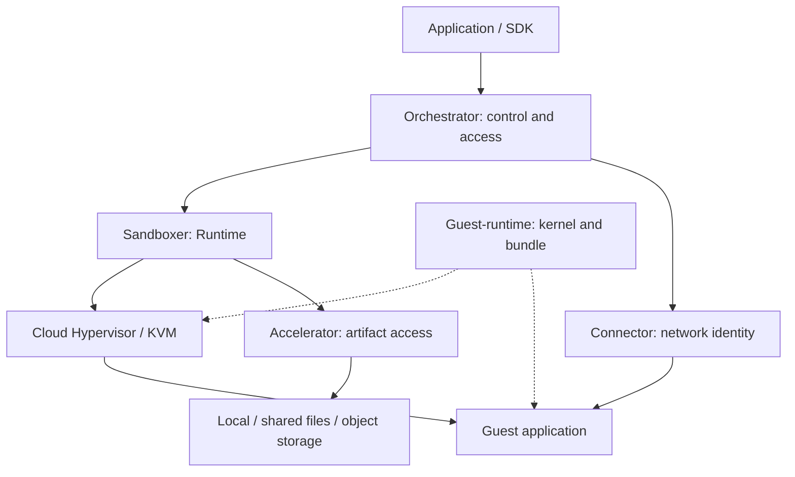

[English](architecture.md) | [简体中文](architecture_zh.md)

# 系统架构、功能树与职责

本文面向平台集成者和维护者，说明能力如何分层、运行时路径以及各规范的权威边界。产品对象见[概念](concepts_zh.md)，组件装配见[部署](deployment_zh.md)。

## 系统路径

实线表示运行时控制或数据关系；虚线表示交付物输入。组件可独立使用，生产平台按任务选择组合。

## 功能树与权威主题

| 能力分支 | 维护中的功能 | 权威来源与阅读入口 |
| --- | --- | --- |
| 应用生命周期 | 模板构建与就绪检查；创建、执行、文件和端口；暂停、连接、重置、删除；TTL 与条件空闲暂停 | [沙箱使用](sandboxes_zh.md)、[模板使用](templates_zh.md)；Orchestrator 生命周期、Build、Proxy |
| 节点和集群控制 | 服务恢复、预留准入、grant 和水位；Group/provider、放置、路由所有权与扩展 | [部署](deployment_zh.md)；Orchestrator node/resource/cluster/extensions |
| Runtime 执行 | Runtime SDK 与薄封装 CLI、冷启动和内存恢复、捕获协调、Guest 与 VMM 边界 | [Runtime](https://github.com/kuasar-sandbox/sandboxer/blob/main/docs/runtime_zh.md)、configuration、guest-abi、vmm |
| Runtime 状态 | E/S 逻辑制品、内存缺页加载/预取/脏页捕获、块 COW/checkpoint/pin/GC、本地资源执行和用量 | Sandboxer artifacts/memory/block-storage/resources |
| 数据访问与生产 | 稀疏引用和载体、完整性/加密、入库读取、持久 Store、分层 Cache、OCI 到 EROFS 生产 | [Accelerator](https://github.com/kuasar-sandbox/accelerator/blob/main/README_zh.md#按完整任务或契约阅读) |
| 网络 | 可信端口身份、隔离与转发、管理路由、网关集成及 TAPFD 所有权 | [Connector](https://github.com/kuasar-sandbox/connector/blob/main/README_zh.md#按任务阅读) |
| Guest 交付 | Runtime bundle、内核能力与补丁、flatten CLI、原生构建和打包 | [Guest-runtime](https://github.com/kuasar-sandbox/guest-runtime/blob/main/README_zh.md#按流程或交付契约阅读) |
| 运行与交付保障 | 日志、原生 usage、Telemetry 指标、诊断和保留；兼容升级；测量、CI、聚合发布 | [运维](operations_zh.md)、[升级](upgrading_zh.md)、[性能](performance_zh.md)、[CI](ci_zh.md)、[发布](release_zh.md) |

本轮审查的 Orchestrator 源码已实现独立 OpenTelemetry 指标服务和原生 Collector pipeline；
应核对所选发行版的[观测范围](https://github.com/kuasar-sandbox/orchestrator/blob/main/docs/observability_zh.md)。
外部策略网关属于集成边界，节点本地轻量 Egress 仍是[提案](https://github.com/kuasar-sandbox/connector/issues/9)，
不能当作 vSwitch 已交付策略引擎。当前源码存在某能力，不代表旧聚合版本已经包含。

## 组件职责

| 组件 | 系统职责 |
|---|---|
| `orchestrator` | `node-ctl` 提供单节点 E2B 兼容服务,节点准入和恢复;`cluster-ctl` 的 registry,router,placer 提供 group-scoped 集群控制面 |
| `sandboxer` | 驱动 Cloud Hypervisor 和 Guest,执行 MicroVM 创建,运行,快照,恢复,销毁和单沙箱资源闭环 |
| `accelerator` | 为镜像,快照和稀疏工件提供本地/远程引用,Manifest,store,cache,OCI 拉取与 EROFS 展平能力 |
| `connector` | 提供 eBPF/TC vSwitch,TAP 交接,网络资源生命周期,沙箱隔离和外部网关集成基础 |
| `guest-runtime` | 构建并发布 Guest runtime 镜像和 Guest kernel 两个发布单元 |

主仓不复制这些实现.它维护系统级设计,跨组件真实 MicroVM E2E,公共执行环境和精确
版本组合的聚合 Release.

## 依赖边界

组件依赖保持薄而明确:

| 层次 | 依赖 |
| --- | --- |
| T0 | accelerator, connector, guest-runtime/native-deps |
| T1 | sandboxer → accelerator, connector/pkg/tapfd |
| T2 | orchestrator → sandboxer, accelerator, connector |

实现留在所属组件内部,跨仓只导出具体包.上表描述仓库级关系,不是完整的包依赖白名单:
orchestrator 使用 sandboxer 的资源和工件/恢复 API,MMDS source 索引还使用 connector
vSwitch 常量.实际依赖集合由当前 module 文件与 import 确定.五个组件既可组合为完整平台,
也可按场景独立采用.

## 设计原则

1. **隔离优先**:每个沙箱拥有独立 Guest Kernel;共享发生在明确的只读层,可信 host
   数据路径和配置的安全域内.
2. **用户语义稳定**:区分"从模板创建新实例"和"恢复同一个实例",不把上层容量准备
   策略当作另一种快照格式.
3. **数据路径可选择**:本地文件,共享文件存储和 Manifest/对象存储/缓存都是有效
   后端,部署方按可移植性,规模和基础设施选择.
4. **控制与执行分层**:节点控制器负责准入和配置的资源池，sandboxer 负责单沙箱资源执行;
   集群 placer 负责放置,不接管沙箱生命周期.
5. **事实与目标分离**:实现状态,测试结果和设计目标分别标注;性能数字必须携带可复现
   的测试口径.
6. **组件独立**:五个组件仓可独立演进,部署和发布,主仓只承载系统设计,跨组件验证和
   聚合发布.

## 系统边界

Kuasar Sandbox 提供 MicroVM 生命周期,数据访问,节点网络和单节点/集群编排.它不替代:

- 外部身份系统,租户计费,业务工作流和全局容量规划;
- 对象存储,共享文件系统,OCI Registry 或外部策略网关本身;
- 应用内部的内存限制,错误处理和数据分级;
- 由 Issue 或 RFC 描述但尚未合入并发布的能力.

## 配置与契约归属

部署文档维护各配置之间的关系：监听可达性、命名 location 的一致性、可信凭据、
所选制品和启动顺序。行为实现组件维护精确字段与默认值。

| 边界 | 权威来源 |
| --- | --- |
| 受管实例身份与保留 | Orchestrator [沙箱生命周期](https://github.com/kuasar-sandbox/orchestrator/blob/main/docs/sandbox-lifecycle_zh.md) |
| 节点运行、准入、Build 和访问 | Orchestrator node、node-resource、node-build、node-proxy |
| Runtime 声明与跨子系统协调 | Sandboxer [configuration](https://github.com/kuasar-sandbox/sandboxer/blob/main/docs/configuration_zh.md) 与 runtime |
| E/S 逻辑格式与物理可写磁盘 | Sandboxer artifacts 与 block-storage 分别定义 |
| 通用身份、稀疏数据和不可变载体 | Accelerator artifacts；处理命令在 transfer |
| 持久内容与可重建缓存 | Accelerator store 与 cache 分别定义 |
| Host/Guest wire 契约与交付的 Guest 文件 | Sandboxer guest-abi 与 Guest-runtime runtime-bundle/vmlinux 分别定义 |
| 网络行为与 FD 交接 | Connector vswitch 与 tapfd 分别定义 |

指南保留完整示例，精确状态表、wire 版本和格式布局在上述边界内只维护一份。
公开 Go 符号继续由所属包文档说明，存在一个包不自动要求新增一篇手册。

## accelerator 定位

`accelerator` 是面向镜像,快照和稀疏工件的数据访问与存储基础组件.它覆盖:

- 普通与稀疏数据表示,并严格区分 Hole,Zero 和 Data;
- 本地工件,稀疏区域处理,完整性校验和可选加密;
- 本地文件,共享文件和远程内容引用;
- 内容组织与 Manifest;
- 本地/共享文件系统和 S3-compatible store 后端;
- 本地缓存,分布式缓存和回源组成的分层缓存;
- OCI 镜像拉取,确定性 EROFS 展平和 runtime config 投影;
- 按需读取,working-set 加载和显式预取.

内容寻址和去重是其中一种能力,不是 accelerator 的唯一价值.同模板实例首先依赖
父层共享;内容级复用更适合稳定镜像,runtime 和高重复工件,并受内容密钥与安全域
边界约束.

## 高密资源治理

Agent 沙箱通常长期等待,短时突发.系统按以下闭环提高节点有效资源利用率:

空闲 CPU 和非活跃内存可回收，长等待可暂停；节点准入、动态 grant、水位和安全余量共同保护活跃工作。

职责分层如下:

| 组件 | 职责 |
|---|---|
| `sandboxer` | 执行单沙箱资源配置,协同 Guest Balloon,host Cgroup 和 VMM 生命周期,完成增长,收缩,暂停与恢复 |
| `node-ctl` Reservation Controller | 管理节点准入，以及各资源池预算、水位、Grant、Inventory、容量感知恢复和平衡 |

节点控制器不读取或修改沙箱 Cgroup,也不直接调用 VMM Balloon;它只通过资源协议管理
Reservation 和 Grant.增长先取得节点 Grant 再扩大沙箱预算;收缩先由单沙箱闭环收敛,
再释放 Reservation.
长时间不活跃的实例可以暂停，把执行资源归还所属池。Runner 和 Builder pool 在单个资源池内选择执行单元；各池预算约束放置与资源恢复。Pause 释放执行资源后，Resume 可以选择同一节点内另一个符合条件的资源池；这与集群节点放置分别由不同层负责。完整规则见[节点资源](https://github.com/kuasar-sandbox/orchestrator/blob/main/docs/node-resource_zh.md#resource-pools)。

平台保障边界是:在沙箱声明资源和节点准入模型范围内,避免节点级资源复用导致沙箱
OOM 和有效工作丢失.应用仍可能因为自身资源声明,内存上限或行为发生 OOM,平台不作
无条件保证.

高密度是节点资源利用率提高后的结果,而不是孤立追求实例数量.容量必须由实际 workload
的峰值 working set,活跃比例,恢复成本和节点安全余量共同验证.

## 网络目的

`connector` 为沙箱网络提供以下基础:

- 快速分配,恢复和回收沙箱网络资源;
- eBPF/TC 内核态高速转发;
- 沙箱之间默认隔离,不提供任意端口间直通;
- 平台生成并验证可信沙箱网络身份,不信任 Guest 自报身份;
- 将可信身份传递给外部策略网关;
- 为沙箱级公网,私网,DNS,代理和审计策略提供集成基础.

顶层系统只定义这些功能目的.网络位置编码,封装字段和 option 布局属于 connector
组件文档,不是用户首要接口.

## 单节点和集群

单节点由 `node-ctl conductor serve` 管理本机沙箱、构建和可选 Reservation Controller。独立 Proxy 承载数据转发，并向 Conductor 注册以接收受信路由与策略更新。
集群由三个独立 `cluster-ctl` 角色组成:

- `registry`:维护 node,route 和 placer 的可靠执行态;
- `router`:提供 E2B 兼容统一入口,按 sandbox-group 路由;
- `placer`:导入 group 配置并选择候选节点,不拥有沙箱生命周期.

生命周期仍由目标 node 和 sandboxer 执行.公开 Sandbox ID 在同节点恢复,跨节点迁移和
重新放置时保持稳定;节点内部执行 ID 可以随 placement generation 变化.

## 下一步

[安全边界](security_zh.md)、[运维](operations_zh.md)和[升级](upgrading_zh.md)分别维护跨组件任务；性能结论必须保留[测量口径](performance_zh.md)。
