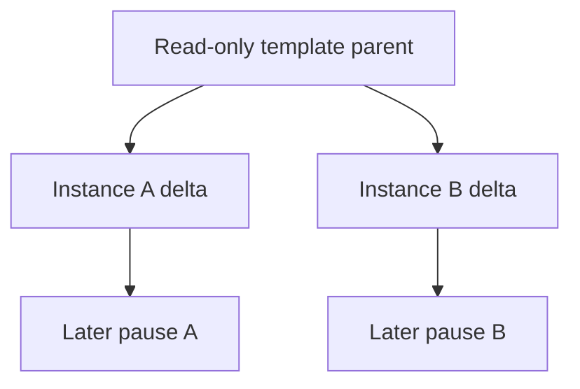

[English](concepts.md) | [简体中文](concepts_zh.md)

# Platform concepts and terminology

Use this guide before creating a template or choosing how to pause and recover a sandbox. It explains which identity is preserved, which state is saved, and which inputs must remain available. No running deployment is required to follow it. [Sandboxes](sandboxes.md) and [templates](templates.md) provide operating steps; component specifications own exact fields, formats and state transitions.

## User scenarios

Kuasar Sandbox addresses these shared needs:

- Agents and Code Interpreters need independent kernel and filesystem state for each session, while avoiding complete initialization from an empty environment every time.
- Serverless and parallel tasks need multiple instances with independent identities created from one prepared environment.
- Reinforcement-learning rollouts need parallel copies of a common initial environment, with each trajectory evolving independently.
- Long sessions wait for model calls, human confirmation or external events. Idle resources should be released during those waits; an instance can be paused when appropriate and later continue the same logical session.
- Both standalone and cluster deployments need explicit boundaries for admission, recovery, network identity and data portability.

The system's capabilities support production deployment. Stable and Preview describe the release stability of public assets and interfaces; they do not replace production configuration of capacity, durable storage, TLS, network policy and credentials by the operator.

## Objects and identities

| Object | What it means to a platform user | Authoritative contract |
| --- | --- | --- |
| Template | Reusable published input from which new independent instances are created | [Template workflow](templates.md) and [Build](https://github.com/kuasar-sandbox/orchestrator/blob/main/docs/node-build.md) |
| Sandbox | One managed logical instance, with an owner, stable identity and retained state; its API/local ID depends on deployment mode. | [Managed lifecycle](https://github.com/kuasar-sandbox/orchestrator/blob/main/docs/sandbox-lifecycle.md) |
| Run | One execution attempt of that instance; its RunID and node-local resources can change | Managed lifecycle; [Runtime](https://github.com/kuasar-sandbox/sandboxer/blob/main/docs/runtime.md) |
| Image | An application filesystem and launch configuration, before a sandbox captures its own disk state | [Image preparation](https://github.com/kuasar-sandbox/accelerator/blob/main/docs/image-preparation.md) |
| Sandbox artifact E | Saved workload configuration and disk graph; no running process memory. It is an input to a run, not the managed Sandbox identity. | [Sandbox artifacts](https://github.com/kuasar-sandbox/sandboxer/blob/main/docs/artifacts.md) |
| Snapshot S | Captured VM memory/state plus a reference to its associated E; not necessarily a self-contained copy of every dependency. | Sandbox artifacts |
| Carrier | A file, Bundle or Manifest representation that transports content | [Generic artifacts](https://github.com/kuasar-sandbox/accelerator/blob/main/docs/artifacts.md) |

A template is the reusable starting point; a managed Sandbox is the session created from it. A Run is one execution of that session. E and S describe saved content, not a running service or an ownership record.

For example, create two sandboxes from one template: pausing one does not pause the other. Resuming it on the same node retains its Sandbox ID and StableID, while RunID and execution resources can change. Creating another sandbox from the template starts a separate session, not a continuation of the paused one.

Keep three identity levels distinct:

- `StableID` identifies the logical sandbox across supported local-ID changes. It is the public SandboxID in a cluster.
- `Sandbox.ID` is the node-local lookup key, called `NodeSandboxID` in the cluster contract. Standalone APIs use this local ID; importing under a different target ID changes it while preserving StableID and service credentials.
- `RunID` identifies one execution attempt and can change after resume or replacement. It is not the identifier an application should use to reconnect to its session.

Identity-preserving import/copy is not an independently authorized fork. Follow the [identity contract](https://github.com/kuasar-sandbox/orchestrator/blob/main/docs/sandbox-lifecycle.md#stable-identity) rather than treating every ID field as interchangeable.

A successful Create or Connect response can accept a launch before the application is ready. Check the application's expected response through its data path. A dead instance, an E-only paused instance and an S-backed paused instance have different recovery choices:

| Intended next step | Required state or input | Process state |
| --- | --- | --- |
| Create an independent session | A usable template and successful admission | Image/E cold-starts; S restores captured state in a compatible environment. |
| Continue a memory-paused session | The accepted S/E pair and its reachable dependencies | Continues captured VM/process state. |
| Cold-start a disk-paused session | Saved E and its dependencies | Starts the application again from saved disks, without its previous process memory. |
| Recover retained disks after termination | Successful Reset of the dead instance, then Connect/Wake | Reset prepares E-only paused state and launches no VM; the later run cold-starts. |

An E-only source cannot supply missing process memory, and a dead instance is not already paused. The [resume contract](https://github.com/kuasar-sandbox/orchestrator/blob/main/docs/sandbox-lifecycle.md#resume) defines mode selection and conflicts; [Reset and retention](https://github.com/kuasar-sandbox/orchestrator/blob/main/docs/sandbox-lifecycle.md#reset-and-retention) defines eligible current disks and retention.

## Snapshot and instance semantics

### Creating new instances from a snapshot template: 1:N

Templates can publish different starting states: Image supplies the application filesystem and launch configuration; E reuses prepared disks without process memory; S restores initialized processes in a compatible execution environment. Choose the [template target](templates.md#choose-the-state-to-publish) for the state the application needs.

Multiple creation requests can reference the same read-only template parent, but each new instance receives its own identity, network identity, credential binding and incremental state. Subsequent writes, process progress and pauses belong only to that instance and do not modify the template or other instances.

This serves Agent, Code Interpreter, RL rollout, Serverless and parallel-task workloads: the template bears the common initialization cost, and each instance evolves independently from the same starting point.

### Pausing and resuming the same instance: 1:1

A memory-capturing pause saves the process, memory and filesystem state of the same logical instance. A disk-only pause saves E and later starts the application again without restoring its previous process memory. Same-node Connect/resume retains both the local Sandbox ID and StableID in either case.

The pause trigger determines which policy applies:

| Trigger | Saved state and policy |
| --- | --- |
| Explicit Pause | Omitted/null/true `memory` saves S with its associated E; `memory: false` saves E only. |
| TTL expiry | `autoPauseMemory` selects S or E-only capture; it does not change explicit Pause's default. |
| Continuous Proxy-observed idle | Enabled by `idleTimeout`; always requests memory capture independently of `autoPauseMemory`. Guest background work and traffic bypassing Proxy are outside the observation and can be frozen. |
| Resource pressure | Uses its own memory-pause and recovery policy, not `autoPauseMemory` or `idleTimeout`. |

The [capture and pause contract](https://github.com/kuasar-sandbox/orchestrator/blob/main/docs/sandbox-lifecycle.md#capture-and-pause) owns the exact prerequisites and defaults. Saved VM memory alone does not guarantee that external peers, transactions or expiring credentials remain usable.

Artifacts kept on the original node can support in-place recovery. Cross-node recovery requires the complete referenced graph, bindings and keys to be accessible at the destination. Publishing a root to a named shared-file location or Manifest is not enough: [publication](https://github.com/kuasar-sandbox/sandboxer/blob/main/docs/artifacts.md#artifact-publication) retains already-published parent references without recursively copying or validating their full historical graph.

Data reachability also does not transfer ownership or establish restore eligibility. Cross-node import/resume requires the applicable migration protocol (including a valid MigrationToken where required), compatible destination inputs and target admission; follow [restore eligibility](upgrading.md#restore-eligibility). StableID is preserved, but a standalone import may change its API/local ID as described above.

This serves waits for model calls, human confirmation or external events, long sessions and node migration. A `warm pool` is an upper-level resource-preparation policy that can keep instances or templates available in advance; it is not an independent snapshot technology.

### Layered snapshots

Snapshot reuse comes from explicit parent relationships:

- Instances created from the same template share the template parent and maintain their own deltas.
- A later pause can capture current disk and memory state as a new layer with an explicit reference to the previous parent.
- Disk artifacts and memory snapshots record their origins separately; restoration validates the complete parent chains.
- Local files, named shared files and Manifest carry the same layering semantics. The carrier does not change the user identity model.

Sharing efficiency does not depend on different running VMs coincidentally producing identical memory bytes. Reusable content comes from explicit template parents, the host page cache for immutable runtime/rootfs content and content organization of stable artifacts within a security domain.

## Unified reference semantics

The upper-level lifecycle uses common artifact references and integrity information rather than requiring all data to be converted to one backend. The supported paths include:

1. **Local files:** suitable for standalone nodes, local NVMe and node-affine workloads. Images, disk layers and snapshots can retain their native file representation.
2. **Shared file storage:** NAS, NFS or another shared filesystem provides native file access across nodes. A named file location can hold snapshots and images directly, without first converting them to content chunks.
3. **Manifest / object storage / tiered cache:** suitable for large-scale distribution, remote persistence, cross-node recovery, on-demand reads and hot-content caching. A Manifest root does not prove that its entire dependency graph is remote: retained file-parent references must also be reachable at the destination. The store backend can be a filesystem or S3-compatible object storage.

Operators can select different paths for different artifacts. For example, temporary node-local state can use NVMe, shared NAS snapshots can use file locations directly, and widely distributed images can use Manifest and tiered caching.

## Sparse and on-demand data

Sparse semantics have three states: Hole comes from authoritative metadata, Zero denotes logical zero data and Data denotes actual content. The system does not scan zero bytes to invent Hole regions. Snapshots and disk layers can be read by reference range. Cache hits and prefetch reduce remote access without changing artifact integrity or parent relationships.

## Glossary

This glossary aligns documentation wording; it does not introduce a new API or replace component specifications. Exact code identifiers remain unchanged.

| Term | Documentation meaning |
| --- | --- |
| Kuasar Sandbox | The overall project, comprising one project repository and five independently evolving component repositories. |
| Project repository | `kuasar-sandbox/kuasar-sandbox`: system-level documentation, integration validation and aggregate releases. |
| Component | `orchestrator`, `sandboxer`, `accelerator`, `connector` or `guest-runtime`; not synonymous with a release unit or daemon. |
| Release unit | One independently versioned artifact line. `guest-runtime` owns runtime and vmlinux lines, yielding six component release units. |
| Aggregate release | An explicitly selected, jointly validated combination of published release units; its version need not match theirs. |
| Snapshot-template instantiation | Create independent instances from a prepared template (1:N). |
| Stateful pause and resume | Save and resume the same logical instance (1:1); distinguish memory restore from explicit cold start. |
| Stable identity | The external logical sandbox identity preserved across supported node-local replacement or migration. Preserve the precise `StableID`, `NodeSandboxID` or other field name in each protocol. |
| Parent layer | Explicitly referenced shared base data; not a claim of identical memory across independently booted VMs. |
| Incremental state | Changes owned by an instance relative to its referenced base. |
| Artifact / carrier | Logical workload content versus its physical representation. Use the owning specification's E/S, image/overlay and carrier definitions. |
| Data path | Local files, named shared-file locations, or Manifest/object-store/cache access as selected by the deployment and artifact reference. |
| On-demand loading | Load the memory pages or disk blocks actually accessed; not an assertion that full artifacts are always downloaded. |
| Prefetch | The existing working-set loading optimization; do not reuse the term for unrelated full-artifact downloads. |
| High-density resource governance | Reclaim and reuse idle capacity while protecting admitted active work; density is a result of improved node utilization, not an unconditional instance count. |
| Capacity | The VM's configured maximum memory; not identical to its current physical charge or node reservation. |
| Headroom | The policy-defined guest memory margin. Use the exact `resources.allocatable.memory` semantics in the owning specification. |
| Node reservation | Node-accounted resources granted to a sandbox; distinct from sandbox-local balloon/cgroup execution and diagnostic host usage. |
| Conductor / Proxy | Lifecycle/control-plane authority versus the independent node data-plane role; describe current deployment modes from the owning source. |
| Registry / Router / Placer | Cluster state, unified ingress/routing, and placement roles; do not assign node lifecycle execution to the placer. |
| Trusted sandbox network identity | Identity established by the host network infrastructure rather than trusting guest-supplied addresses. |
| Policy gateway | An external or separately deployed policy execution plane; network integration infrastructure does not imply every gateway feature is implemented. |
| Security domain | The configured scope of permitted sharing and protection; not unconditional sharing across all tenants. |
| Stable / Preview / Proposed | Public release channel status and proposed-design status are separate from production deployment capability. A proposal is not a delivered feature. |

## Continue with a task

- [Quickstart](quickstart.md): create and clean up a first running sandbox.
- [Templates](templates.md): prepare reusable inputs for independent sessions.
- [Sandboxes](sandboxes.md): operate one session, pause/resume it, or reset retained disks.
- [Upgrading](upgrading.md): check restore eligibility before changing execution inputs or nodes.
