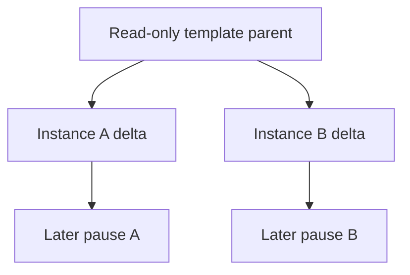

[English](concepts.md) | [简体中文](concepts_zh.md)

# 平台概念与术语

在创建模板或选择暂停、恢复方式前，先阅读本文，弄清哪些身份保持不变、保存了哪些状态，以及哪些输入必须持续可用。阅读无需已运行的部署。[沙箱使用](sandboxes_zh.md)和[模板](templates_zh.md)提供实际步骤；精确字段、格式和状态转换由组件规范维护。

## 用户场景

Kuasar Sandbox 解决以下共同问题:

- Agent 和 Code Interpreter 需要为每个会话提供独立内核与文件系统状态,同时避免
  每次从空环境完成全部初始化.
- Serverless 和并行任务需要从同一个已准备环境创建多个身份独立的实例.
- 强化学习 rollout 需要并行复制统一初始环境,并让每条轨迹独立演进.
- 长会话会在模型调用,人工确认或外部事件期间等待,此时应释放空闲资源,必要时暂停
  实例,之后继续同一个逻辑会话.
- 单节点和集群都需要明确的资源准入,恢复,网络身份和数据可移植边界.

系统能力面向生产部署.公开发行通道的 Stable 或 Preview 状态描述资产与接口的发布
稳定性,不替代部署方对容量,可靠存储,TLS,网络策略和凭据管理的生产配置.

## 对象与身份

| 对象 | 对平台使用者的含义 | 权威规范 |
| --- | --- | --- |
| 模板 | 可复用的已发布输入，用于创建新的独立实例 | [模板使用流程](templates_zh.md)与 [Build](https://github.com/kuasar-sandbox/orchestrator/blob/main/docs/node-build_zh.md) |
| Sandbox | 一个受管逻辑实例，拥有所属用户、稳定身份和保留状态；API/本地 ID 的含义取决于部署模式。 | [受管实例生命周期](https://github.com/kuasar-sandbox/orchestrator/blob/main/docs/sandbox-lifecycle_zh.md) |
| Run | 该实例的一次执行尝试；RunID 和节点本地资源可以变化 | 受管实例生命周期及 [Runtime](https://github.com/kuasar-sandbox/sandboxer/blob/main/docs/runtime_zh.md) |
| Image | 应用文件系统及启动配置，尚未捕获实例自身的磁盘状态 | [镜像生产](https://github.com/kuasar-sandbox/accelerator/blob/main/docs/image-preparation_zh.md) |
| 沙箱制品 E | 保存的工作负载配置与磁盘图，不含运行中进程内存。它是一次运行的输入，不是受管 Sandbox 的身份。 | [沙箱制品](https://github.com/kuasar-sandbox/sandboxer/blob/main/docs/artifacts_zh.md) |
| Snapshot S | 捕获的 VM 内存/状态，以及对关联 E 的引用；不一定自包含所有依赖。 | 沙箱制品规范 |
| 载体 | 用于传输内容的文件、Bundle 或 Manifest 表示 | [通用制品](https://github.com/kuasar-sandbox/accelerator/blob/main/docs/artifacts_zh.md) |

模板是可复用的起点，受管 Sandbox 是从模板创建的会话，Run 是该会话的一次执行。E 和 S 描述保存的内容，不代表正在运行的服务或 ownership 记录。

例如，从同一模板创建两个沙箱，暂停其中一个不会暂停另一个。在同一节点恢复时，Sandbox ID 和 StableID 保持不变，RunID 和执行资源可以变化。再次从模板创建沙箱则是另一个独立会话，不是继续之前暂停的会话。

应区分三个身份层次：

- `StableID` 在受支持的本地 ID 变化中标识同一个逻辑沙箱。在集群中，它是公开 SandboxID。
- `Sandbox.ID` 是节点本地查找键，在集群契约中称为 `NodeSandboxID`。单节点 API 使用这个本地 ID；以不同目标 ID 导入时，它会改变，而 StableID 和服务凭据保持不变。
- `RunID` 标识一次执行尝试，恢复或替换执行后可以变化。应用不应拿它作为重新连接会话的标识。

保留身份的导入/复制不是获得独立授权的新分支。应遵循[身份契约](https://github.com/kuasar-sandbox/orchestrator/blob/main/docs/sandbox-lifecycle_zh.md#stable-identity)，不能把各 ID 字段互换使用。

Create 或 Connect 成功可能只表示启动已被接受，应用尚未就绪。应通过应用的数据路径检查预期响应。dead 实例、仅含 E 的 paused 实例和含 S 的 paused 实例有不同恢复选择：

| 下一步目标 | 所需状态或输入 | 进程状态 |
| --- | --- | --- |
| 创建独立会话 | 可用模板与成功准入 | Image/E 冷启动；S 在兼容环境中恢复捕获的状态。 |
| 继续已保存内存的暂停会话 | 已接受的 S/E 对及其可达依赖 | 继续捕获的 VM/进程状态。 |
| 冷启动仅保存磁盘的暂停会话 | 已保存的 E 及其依赖 | 从保存的磁盘重新启动应用，不带回先前进程内存。 |
| 终止后恢复保留的磁盘 | 对 dead 实例成功 Reset，然后 Connect/Wake | Reset 准备 E-only paused 状态，不启动 VM；后续运行采用冷启动。 |

E-only 来源无法提供缺失的进程内存，dead 实例也不是已经暂停的实例。[恢复契约](https://github.com/kuasar-sandbox/orchestrator/blob/main/docs/sandbox-lifecycle_zh.md#resume)定义模式选择和冲突；[Reset 与保留](https://github.com/kuasar-sandbox/orchestrator/blob/main/docs/sandbox-lifecycle_zh.md#reset-and-retention)定义哪些当前磁盘可以恢复，以及保留期限。

## 快照与实例语义

### 从快照模板创建新实例:1:N

模板可以发布不同的起始状态：Image 提供应用文件系统和启动配置；E 复用已准备的磁盘，不保存进程内存；S 在兼容执行环境中恢复已初始化的进程。应按应用所需状态选择[模板目标](templates_zh.md#选择要发布的状态)。

多个创建请求可以引用同一个只读模板父层，但每个新实例获得独立身份、网络身份、凭据绑定和增量状态。后续写入、进程推进和暂停只属于该实例，不会反写模板或其他实例。

这种语义适用于 Agent,Code Interpreter,RL rollout,Serverless 和并行任务:共同的
初始化成本由模板承担,每个实例从统一起点独立演进.

### 暂停并恢复同一个实例:1:1

捕获内存的暂停保存同一个逻辑实例的进程、内存和文件系统状态。仅保存磁盘的暂停保存 E，之后重新启动应用，不恢复先前进程内存。两种情况下，同节点 Connect/Resume 都保持本地 Sandbox ID 和 StableID 不变。

暂停的触发来源决定适用的策略：

| 触发来源 | 保存状态及策略 |
| --- | --- |
| 显式 Pause | `memory` 缺省、null 或 true 时保存 S 及关联 E；`memory: false` 仅保存 E。 |
| TTL 到期 | `autoPauseMemory` 选择保存 S 或仅保存 E，不改变显式 Pause 的默认行为。 |
| Proxy 持续观察到空闲 | 由 `idleTimeout` 启用，始终请求保存内存，不受 `autoPauseMemory` 控制。Guest 后台工作及绕过 Proxy 的流量不在观察范围内，可能随 VM 被冻结。 |
| 资源压力 | 采用独立的内存暂停和恢复策略，不由 `autoPauseMemory` 或 `idleTimeout` 配置。 |

[捕获与暂停契约](https://github.com/kuasar-sandbox/orchestrator/blob/main/docs/sandbox-lifecycle_zh.md#capture-and-pause)维护精确前提和默认值。仅保存 VM 内存，不能保证外部对端、事务或有时效的凭据继续可用。

制品保留在原节点时可以支持原地恢复。跨节点恢复要求目标能够访问完整引用图、绑定和密钥。仅把根制品发布到命名共享文件位置或 Manifest 还不够：[发布](https://github.com/kuasar-sandbox/sandboxer/blob/main/docs/artifacts_zh.md#artifact-publication)会保留已经发布的父层引用，不会递归复制或验证其完整历史图。

数据可达也不转移 ownership 或证明满足恢复资格。跨节点导入/恢复还须满足适用迁移协议（需要时提供有效 MigrationToken）、执行输入兼容性及目标准入，详见[恢复资格](upgrading_zh.md#restore-eligibility)。StableID 保持不变，但单节点导入的 API/本地 ID 可能改变，具体区别见前文。

这种语义适用于等待模型调用,人工确认,外部事件,长会话和节点迁移.预热池
(`warm pool`)只是一种上层资源准备策略,可以提前维持可用实例或模板,不是独立的
快照技术路线.

### 分层快照

快照复用来自明确的父层关系:

- 同一模板创建的实例共享模板父层,各自只维护增量.
- 后续暂停可以把当前磁盘和内存状态作为新层,并显式引用先前父层.
- 磁盘工件与内存快照分别记录来源,恢复时校验完整父链.
- 本地,命名共享文件和 Manifest 都承载同一层级语义,载体不改变用户身份模型.

共享效率不依赖不同虚机运行后偶然产生相同内存字节.可复用内容来自明确模板父层,
不可变 runtime/rootfs 的 host page cache,以及安全域内稳定工件的内容组织.

## 统一引用语义

上层生命周期使用统一的工件引用和完整性信息,而不是要求所有数据先转换成同一种后端.
当前有效路径包括:

1. **本地文件**:适合单节点,本地 NVMe 和节点亲和工作负载.镜像,磁盘层和快照可以
   保持原生文件形态.
2. **共享文件存储**:NAS,NFS 或其他共享文件系统提供跨节点原生文件访问.命名文件
   location 可以直接承载快照和镜像,不要求先转换为内容分片.
3. **Manifest / 对象存储 / 分层缓存**:适合大规模分发,远程持久化,跨节点恢复,
   按需读取和热点缓存。根制品是 Manifest 并不表示整个依赖图都已远程化；保留的文件父引用也必须在目标端可达。store 后端可以是文件系统或
   S3-compatible 对象存储。

部署方可以为不同工件选择不同路径.例如,节点本地临时状态使用 NVMe,共享 NAS 快照
直接使用文件位置,需要广泛分发的镜像使用 Manifest 与分层缓存.

## 稀疏与按需数据

稀疏语义是三态:Hole 来自权威元数据,Zero 表示逻辑零数据,Data 表示实际内容.系统
不会扫描零字节来创造 Hole.快照和磁盘层可以按引用范围读取,cache 命中与预取减少
远端访问,但不改变工件的完整性和父层关系.

## 术语表

本表统一文档表达，不引入新 API，也不替代组件规范。精确代码标识符保持不变。

| 术语 | 文档含义 |
| --- | --- |
| Kuasar Sandbox | 整体项目，由一个项目主仓及五个独立演进的组件仓组成。 |
| 项目主仓 | `kuasar-sandbox/kuasar-sandbox`：系统文档、集成验证和聚合发布。 |
| 组件 | `orchestrator`、`sandboxer`、`accelerator`、`connector`、`guest-runtime`；不等同于发布单元或守护进程。 |
| 发布单元 | 独立版本化的制品线。`guest-runtime` 拥有 runtime 与 vmlinux 两条线，因而共六个组件发布单元。 |
| 聚合版本 | 显式选择、联合验证的已发布单元组合；版本号不必与组件相同。 |
| 快照模板实例化 | 从准备好的模板创建独立实例，1:N。 |
| 有状态暂停与恢复 | 保存并恢复同一逻辑实例，1:1；区分内存恢复与显式冷启动。 |
| 稳定身份 | 在支持的节点本地替换或迁移中保留的外部逻辑沙箱身份；在各协议中保留精确的 `StableID`、`NodeSandboxID` 等字段名。 |
| 父层 | 显式引用的共享基础数据，不表示独立冷启动虚机具有相同内存。 |
| 增量状态 | 实例相对引用基础层拥有的变化。 |
| 工件与载体 | 逻辑工作负载内容与其物理表示；采用归属规范中的 E/S、image/overlay 及 carrier 定义。 |
| 数据路径 | 由部署和工件引用选择的本地文件、命名共享文件位置或 Manifest/对象存储/缓存访问。 |
| 按需加载 | 加载实际访问的内存页或磁盘块，不表示总要下载完整工件。 |
| Prefetch | 已有的工作集预加载优化，不用于表示无关的全量工件下载。 |
| 高密资源治理 | 回收复用空闲容量，同时保护已准入的活跃工作；高密度是节点利用率提升的结果，不是无条件实例数量承诺。 |
| Capacity | VM 配置的最大内存，不等于当前物理占用或节点预留。 |
| Headroom | 策略定义的 Guest 内存余量；采用归属规范中 `resources.allocatable.memory` 的精确语义。 |
| 节点预留 | 节点为沙箱记账并授予的资源，区别于沙箱内部 Balloon/Cgroup 执行及诊断性宿主用量。 |
| Conductor / Proxy | 生命周期/控制面权威与独立节点数据面角色；部署模式按归属来源描述。 |
| Registry / Router / Placer | 集群状态、统一入口及路由、放置角色；不把节点生命周期执行职责归给 Placer。 |
| 可信沙箱网络身份 | 由宿主网络基础设施建立的身份，而非信任 Guest 自报的地址。 |
| 策略网关 | 外部或单独部署的策略执行平面；网络集成基础不表示所有网关功能均已实现。 |
| 安全域 | 配置的共享与保护范围，不是无条件跨所有租户共享。 |
| Stable / Preview / Proposed | 公开发行通道及设计提案状态与生产部署能力分别描述；提案不是已交付功能。 |

## 继续完成实际任务

- [快速开始](quickstart_zh.md)：创建并清理第一个运行中的沙箱。
- [模板](templates_zh.md)：为独立会话准备可复用输入。
- [沙箱使用](sandboxes_zh.md)：操作一个会话、暂停恢复或重置保留的磁盘。
- [升级](upgrading_zh.md)：改变执行输入或节点前，先检查恢复资格。
