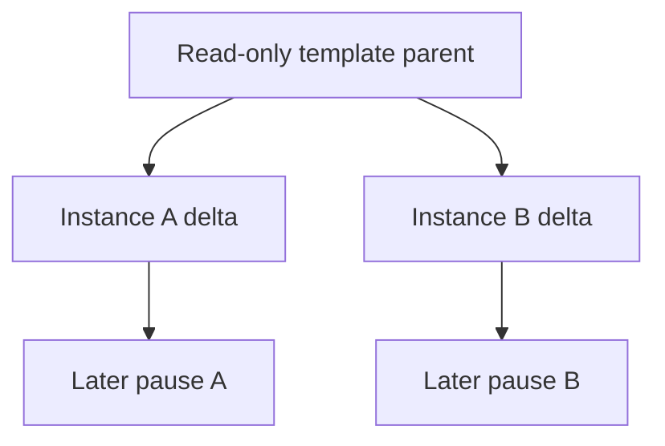

[English](concepts.md) | [简体中文](concepts_zh.md)

# 平台概念与术语

本文帮助应用开发者理解平台对象、实例身份与保存状态。完整操作见[沙箱使用](sandboxes_zh.md)和[模板](templates_zh.md)；组件内部字段和编码由对应规范维护。

## 用户场景

Kuasar Sandbox 解决以下共同问题:

- Agent 和 Code Interpreter 需要为每个会话提供独立内核与文件系统状态,同时避免
  每次从空环境完成全部初始化.
- Serverless 和并行任务需要从同一个已准备环境创建多个身份独立的实例.
- 强化学习 rollout 需要并行复制统一初始环境,并让每条轨迹独立演进.
- 长会话会在模型调用,人工确认或外部事件期间等待,此时应释放空闲资源,必要时暂停
  实例,之后继续同一个逻辑会话.
- 单节点和集群都需要明确的资源准入,恢复,网络身份和数据可移植边界.

系统能力面向生产部署.公开发行通道的 Stable 或 Preview 状态描述资产与接口的发布
稳定性,不替代部署方对容量,可靠存储,TLS,网络策略和凭据管理的生产配置.

## 对象与身份

| 对象 | 对平台使用者的含义 | 权威规范 |
| --- | --- | --- |
| 模板 | 可复用的已发布输入，用于创建新的独立实例 | [模板使用流程](templates_zh.md)与 [Build](https://github.com/kuasar-sandbox/orchestrator/blob/main/docs/node-build_zh.md) |
| Sandbox | 一个受管逻辑实例，拥有所属用户、稳定公开身份和保留状态 | [受管实例生命周期](https://github.com/kuasar-sandbox/orchestrator/blob/main/docs/sandbox-lifecycle_zh.md) |
| Run | 该实例的一次执行尝试；RunID 和节点本地资源可以变化 | 受管实例生命周期及 [Runtime](https://github.com/kuasar-sandbox/sandboxer/blob/main/docs/runtime_zh.md) |
| Image | 应用文件系统及启动配置，尚未捕获实例自身的磁盘状态 | [镜像生产](https://github.com/kuasar-sandbox/accelerator/blob/main/docs/image-preparation_zh.md) |
| Sandbox E | 可移植的工作负载配置与磁盘图，不含运行中进程内存 | [沙箱制品](https://github.com/kuasar-sandbox/sandboxer/blob/main/docs/artifacts_zh.md) |
| Snapshot S | 捕获的 VM 内存/状态，以及对 E 的引用 | 沙箱制品规范 |
| 载体 | 用于传输内容的文件、Bundle 或 Manifest 表示 | [通用制品](https://github.com/kuasar-sandbox/accelerator/blob/main/docs/artifacts_zh.md) |

控制请求成功可能只表示已接受启动，应用尚未就绪。应通过数据路径检查应用行为。
dead 实例、仅含 E 的 paused 实例和含 S 的 paused 实例有不同恢复选择，
精确状态转换由受管生命周期规范定义。

## 快照与实例语义

### 从快照模板创建新实例:1:N

模板在发布前完成环境,依赖和可选应用进程的初始化.多个创建请求可以引用同一个只读
模板父层,但每个实例获得独立 Sandbox ID,网络身份,凭据绑定和增量状态.后续写入,
进程推进和暂停只属于该实例,不会反写模板或其他实例.

这种语义适用于 Agent,Code Interpreter,RL rollout,Serverless 和并行任务:共同的
初始化成本由模板承担,每个实例从统一起点独立演进.

### 暂停并恢复同一个实例:1:1

捕获内存的暂停保留同一个逻辑实例的进程、内存和文件系统状态;显式 pause 默认采用
这种快照行为.指定 `memory: false` 时暂停保存磁盘工件,之后重新启动应用,不恢复先前
进程内存.`autoPauseMemory` 独立选择自动暂停时的捕获行为.两种情况下,连接/恢复都
继续使用稳定的公开 Sandbox ID.工件保留在原节点时可以原地恢复;工件发布到命名共享文件位置或 Manifest 后解决跨节点数据可达性。跨节点导入/恢复还须保有 ownership、满足适用迁移协议（需要时提供有效 MigrationToken）、目标准入及执行输入兼容性，详见[恢复资格](upgrading_zh.md#restore-eligibility)。节点内部执行 ID 可以变化，公开身份不变。

这种语义适用于等待模型调用,人工确认,外部事件,长会话和节点迁移.预热池
(`warm pool`)只是一种上层资源准备策略,可以提前维持可用实例或模板,不是独立的
快照技术路线.

### 分层快照

快照复用来自明确的父层关系:

- 同一模板创建的实例共享模板父层,各自只维护增量.
- 后续暂停可以把当前磁盘和内存状态作为新层,并显式引用先前父层.
- 磁盘工件与内存快照分别记录来源,恢复时校验完整父链.
- 本地,命名共享文件和 Manifest 都承载同一层级语义,载体不改变用户身份模型.

共享效率不依赖不同虚机运行后偶然产生相同内存字节.可复用内容来自明确模板父层,
不可变 runtime/rootfs 的 host page cache,以及安全域内稳定工件的内容组织.

## 统一引用语义

上层生命周期使用统一的工件引用和完整性信息,而不是要求所有数据先转换成同一种后端.
当前有效路径包括:

1. **本地文件**:适合单节点,本地 NVMe 和节点亲和工作负载.镜像,磁盘层和快照可以
   保持原生文件形态.
2. **共享文件存储**:NAS,NFS 或其他共享文件系统提供跨节点原生文件访问.命名文件
   location 可以直接承载快照和镜像,不要求先转换为内容分片.
3. **Manifest / 对象存储 / 分层缓存**:适合大规模分发,远程持久化,跨节点恢复,
   按需读取和热点缓存.工件不依赖原节点文件;store 后端可以是文件系统或
   S3-compatible 对象存储.

部署方可以为不同工件选择不同路径.例如,节点本地临时状态使用 NVMe,共享 NAS 快照
直接使用文件位置,需要广泛分发的镜像使用 Manifest 与分层缓存.

## 稀疏与按需数据

稀疏语义是三态:Hole 来自权威元数据,Zero 表示逻辑零数据,Data 表示实际内容.系统
不会扫描零字节来创造 Hole.快照和磁盘层可以按引用范围读取,cache 命中与预取减少
远端访问,但不改变工件的完整性和父层关系.

## 术语表

本表统一文档表达，不引入新 API，也不替代组件规范。精确代码标识符保持不变。

| 术语 | 文档含义 |
| --- | --- |
| Kuasar Sandbox | 整体项目，由一个项目主仓及五个独立演进的组件仓组成。 |
| 项目主仓 | `kuasar-sandbox/kuasar-sandbox`：系统文档、集成验证和聚合发布。 |
| 组件 | `orchestrator`、`sandboxer`、`accelerator`、`connector`、`guest-runtime`；不等同于发布单元或守护进程。 |
| 发布单元 | 独立版本化的制品线。`guest-runtime` 拥有 runtime 与 vmlinux 两条线，因而共六个组件发布单元。 |
| 聚合版本 | 显式选择、联合验证的已发布单元组合；版本号不必与组件相同。 |
| 快照模板实例化 | 从准备好的模板创建独立实例，1:N。 |
| 有状态暂停与恢复 | 保存并恢复同一逻辑实例，1:1；区分内存恢复与显式冷启动。 |
| 稳定身份 | 在支持的节点本地替换或迁移中保留的外部逻辑沙箱身份；在各协议中保留精确的 `StableID`、`NodeSandboxID` 等字段名。 |
| 父层 | 显式引用的共享基础数据，不表示独立冷启动虚机具有相同内存。 |
| 增量状态 | 实例相对引用基础层拥有的变化。 |
| 工件与载体 | 逻辑工作负载内容与其物理表示；采用归属规范中的 E/S、image/overlay 及 carrier 定义。 |
| 数据路径 | 由部署和工件引用选择的本地文件、命名共享文件位置或 Manifest/对象存储/缓存访问。 |
| 按需加载 | 加载实际访问的内存页或磁盘块，不表示总要下载完整工件。 |
| Prefetch | 已有的工作集预加载优化，不用于表示无关的全量工件下载。 |
| 高密资源治理 | 回收复用空闲容量，同时保护已准入的活跃工作；高密度是节点利用率提升的结果，不是无条件实例数量承诺。 |
| Capacity | VM 配置的最大内存，不等于当前物理占用或节点预留。 |
| Headroom | 策略定义的 Guest 内存余量；采用归属规范中 `resources.allocatable.memory` 的精确语义。 |
| 节点预留 | 节点为沙箱记账并授予的资源，区别于沙箱内部 Balloon/Cgroup 执行及诊断性宿主用量。 |
| Conductor / Proxy | 生命周期/控制面权威与独立节点数据面角色；部署模式按归属来源描述。 |
| Registry / Router / Placer | 集群状态、统一入口及路由、放置角色；不把节点生命周期执行职责归给 Placer。 |
| 可信沙箱网络身份 | 由宿主网络基础设施建立的身份，而非信任 Guest 自报的地址。 |
| 策略网关 | 外部或单独部署的策略执行平面；网络集成基础不表示所有网关功能均已实现。 |
| 安全域 | 配置的共享与保护范围，不是无条件跨所有租户共享。 |
| Stable / Preview / Proposed | 公开发行通道及设计提案状态与生产部署能力分别描述；提案不是已交付功能。 |

MUST/MUST NOT/SHOULD/SHOULD NOT/MAY 的使用必须保持源要求的强度。设计规范保留技术细节，总览与宣传材料以功能价值为主。
