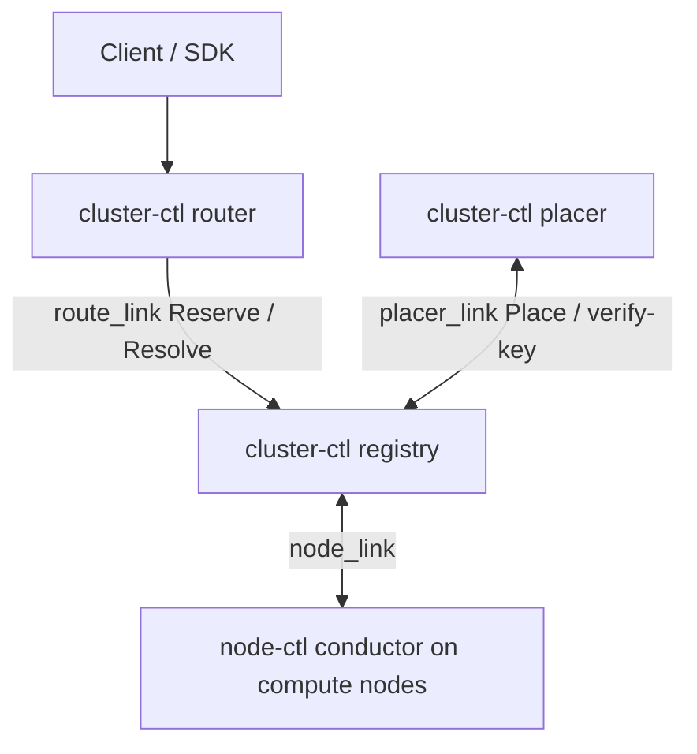
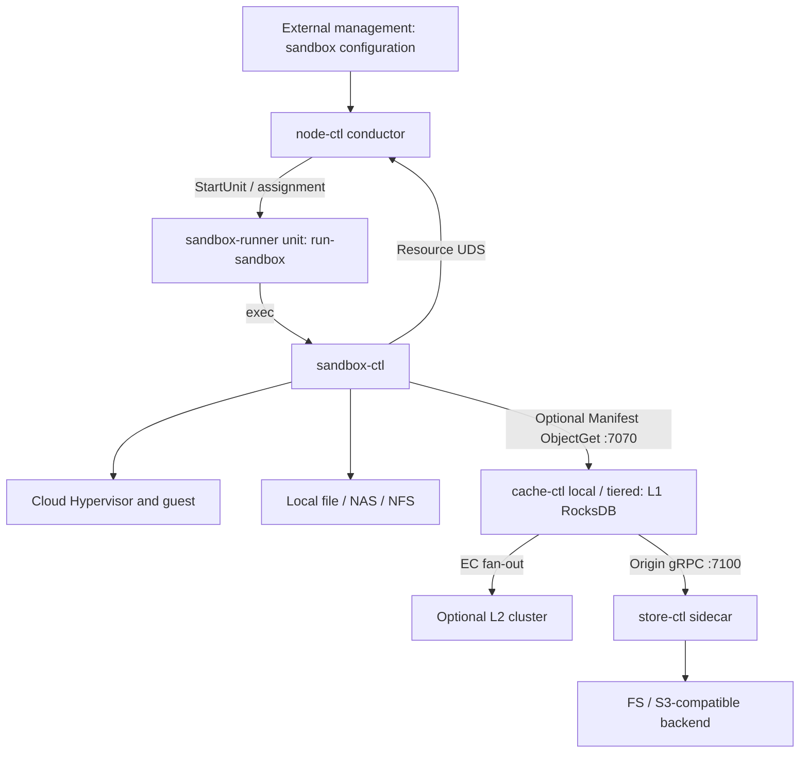
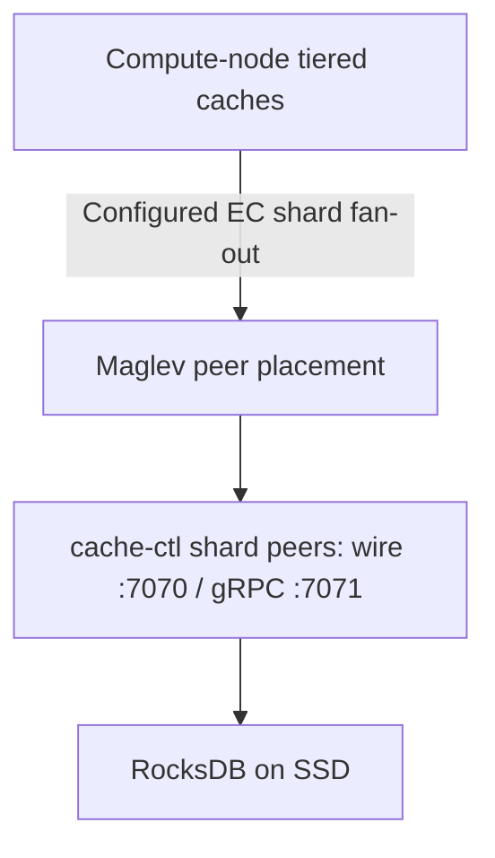
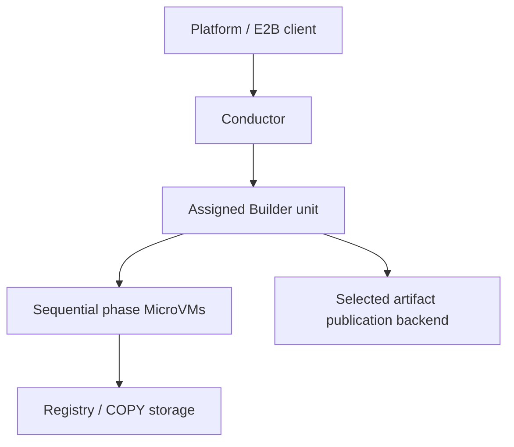

[English](deployment.md) | [简体中文](deployment_zh.md)

# Deployment topology, assembly and acceptance

For operators assembling production nodes or clusters. Acquire matching inputs through [installation](installation.md); use [Quick Start](quickstart.md) for first use. Workbench is a development/test environment, while production runs independently. Components own complete CLI/configuration/internal contracts; this guide owns process placement, connections and dependency order.

## Role overview

Select roles according to the data path and control-plane topology. Local files, shared files and Manifest/store/cache are separate choices; Manifest and caching are not prerequisites for either standalone or cluster deployment.

**Node and cluster roles**

| Role | Responsibility | Main processes |
|---|---|---|
| Compute Node | Hosts MicroVMs and node resource control; E2B template builds also run in build sandboxes on this node ([Build deployment](#build-deployment)). | `node-ctl conductor serve`, optionally with `resource_listen`; independent Proxy master and workers; `sandbox-ctl × N`. Deploy `cache-ctl` when selected for the Manifest path, and `store-ctl` when source access, publication or configured write admission requires it. |
| Shared Storage | Native cross-node file access for named `file://` locations. | Operator-provided NAS, NFS or shared filesystem. |
| L2 Cache Cluster (optional) | Distributed EC caching for the Manifest path; without it, cache can hit locally or read the origin. | `cache-ctl shard`. |
| Cluster Control Plane (optional) | E2B-compatible multi-node control: registry maintains execution state, router supplies the common entry point, and placer imports groups and selects placement. Nodes still execute lifecycle operations. | `cluster-ctl registry`, `cluster-ctl router`, `cluster-ctl placer`. |

**External shared resources**, operated outside the platform:

| Resource | Purpose |
|---|---|
| Local/NAS/NFS | Local or shared native-file artifacts, without mandatory conversion to content chunks. |
| FS or S3-compatible store | Durable backend for Manifests and chunks. |
| Platform management plane | Instance scheduling, configuration, tenancy and template-build credentials (registry pull tokens/customer keys). Imports sandbox-group configuration through the cluster placer/provider, or calls the standalone `node-ctl` E2B API directly. |
| Container registry | Tenant image source, pulled as needed by `flatten-ctl` in the build sandbox; supports OCI 1.1 Referrers. |

## Compute Node

### Resident processes

| Process | Role | Count | Lifecycle | Owner |
|---|---|---|---|---|
| `node-ctl conductor serve` | Local orchestration, E2B-compatible control plane, optional node resource arbitration and node-link client. Drives sandbox-ctl through `sandbox-runner@<run-id>` and `sandbox-builder@<run-id>`. The independent Proxy owns sandbox data ingress; conductor does not serve the data plane. | One conductor per node. | systemd. | [orchestrator/node](https://github.com/kuasar-sandbox/orchestrator/blob/main/docs/node.md); resource protocol in [node-resource](https://github.com/kuasar-sandbox/orchestrator/blob/main/docs/node-resource.md). |
| `node-ctl proxy serve` | Master subscribes to routes and conductor-owned MMDS policy over config-socket, binds data/MMDS listeners and manages workers. Workers read fixed routes through mmap and query mutable MMDS routes/values/services through local master RPC; they authenticate and proxy data traffic, including the native exec gate. | One master plus configured `workers`. | systemd. | [orchestrator/node-proxy](https://github.com/kuasar-sandbox/orchestrator/blob/main/docs/node-proxy.md). |
| `cache-ctl` (`mode: local|tiered`, optional) | Manifest read entry: local L1, optional EC L2 and store origin. | Commonly one per selected cache configuration; separate domains can use separate instances. | systemd; start before consumers of this Manifest path. | [accelerator/cache](https://github.com/kuasar-sandbox/accelerator/blob/main/docs/cache.md). |
| `store-ctl` (optional) | Node-side read/write service for FS/S3-compatible Manifest storage. | Commonly one sidecar per node/storage configuration. | systemd; required when selected source access, publication or configured write admission uses Store ([Build deployment](#build-deployment)). | [accelerator/store](https://github.com/kuasar-sandbox/accelerator/blob/main/docs/store.md). |
| `sandbox-ctl run` | Controls one sandbox, similar in lifecycle to `runc run`; not a shared daemon. | One per sandbox. | Assigned by node-ctl through `sandbox-runner@<run-id>` and its `run-sandbox` launcher. | [Sandboxer Runtime](https://github.com/kuasar-sandbox/sandboxer/blob/main/docs/runtime.md). |
| `cloud-hypervisor` | Patched VMM, child of sandbox-ctl. | One per sandbox. | Spawned by sandbox-ctl. | [Sandboxer VMM](https://github.com/kuasar-sandbox/sandboxer/blob/main/docs/vmm.md). |
| `connector-ctl vswitch start/serve` | Pre-established kernel data plane, trusted port identity and optional TAPFD service | One data plane per selected switch; serve is an optional resident control process | Start and check readiness before Conductor allocates network resources; kernel forwarding does not relay each packet through userspace | [Network operations](https://github.com/kuasar-sandbox/connector/blob/main/docs/vswitch-operations.md) |
| `node-ctl telemetry serve` (optional) | Native metric collection, export and history queries | Selected by observability configuration | Deploy independently with the selected version's Collector, storage and query settings | [Observability](https://github.com/kuasar-sandbox/orchestrator/blob/main/docs/observability.md) |

### Ports and sockets

Bind node-local storage, cache and control services to loopback or UDS. Public API/data listeners and L2 peer listeners are deliberate exceptions. The addresses below are deployment examples/conventions; the selected configuration determines actual listeners.

| Process | Listener | Protocol | Purpose |
|---|---|---|---|
| `store-ctl` | `127.0.0.1:7100` | gRPC | Persistent-object reads, write admission and writes for local clients; the Store specification owns the RPC schema. |
| `store-ctl` | `127.0.0.1:7061` | gRPC health | Probes. |
| `cache-ctl tiered` | `127.0.0.1:7070` | Custom binary TCP wire | sandbox-ctl/manifest-ctl chunk reads. |
| `cache-ctl tiered` | `127.0.0.1:7071` | gRPC | Health, `ping`, `info`. |
| `node-ctl conductor serve` (`resource_listen`) | `/run/sandbox-resource.sock` | Resource protocol over UDS | sandbox-ctl resource-controller dial target. |
| `sandbox-ctl` | `<run_root>/sandboxes/<sid>/*.sock` for node-managed sandboxes | UDS | `ch.sock`, `blk{0,1}.sock`, `uffd.sock`, `ctl.sock`, `vsock.sock` and `_5000`; the runtime PID file identifies sandbox-ctl. Sandbox bootstrap/prepare on config-socket authenticates the parent RunID process against `<run_root>/runners/<run-id>.pid`. Assignment/launch parameters come through config-socket, not an `SANDBOX_ARGS` envfile. |
| `node-ctl conductor serve` | `api.listen`, e.g. `:443` | HTTPS/h2 or HTTP/h2c, according to topology | E2B control API; the independent Proxy supplies the separate data entry. See [cluster listener constraints](#relationship-to-nodes-and-external-management). |
| `node-ctl proxy serve` | `proxy.yaml.data_listen` | HTTPS/h2 or h2c | Separate data entry. Master binds the listener and passes FDs to workers. Native exec uses CONNECT with `service=exec` and `X-Access-Token`. |
| Proxy master/workers | Conductor `mmds.listen`, default `127.0.0.1:19254` | HTTP/1.1 | Target of vswitch `--mgmt-service`. The master receives trusted conductor policy, binds the listener and passes its FD to workers. |
| MMDS local service | `mmds.services.<name>.endpoint` | HTTP/1.1 over UDS | Conductor-only registry; V1 requires an absolute `unix://` path. Workers obtain a permitted resolved socket path from their master. |
| `node-ctl conductor serve` | `/run/sandbox/node-ctl.socket` | HTTP/h2c and framed JSON streams over UDS | Five config-socket planes: run/task/admin/plugin/api. Launchers obtain task/launch/build specifications; admin manages Manifest keys and sandbox MMDS values; external proxy/platform extensions register and synchronize permitted routes over the plugin plane. Authentication uses SO_PEERCRED and task/runner/admin/plugin pidfiles. |

Tiered cache dials L2 peer port `7070` through the node network ([L2 Cache](#l2-cache-cluster)). Local cache or direct store access does not require L2. `node-ctl proxy serve` starts one master and the configured workers. Data traffic enters `proxy.yaml.data_listen`; control traffic remains at conductor `api.listen`.

External workers require node-local `proxy.yaml.paths.run_root`. They derive `<run_root>/sandboxes/<NodeSandboxID>/ctl.sock`; routesync Policy and the shared-memory route view do not carry this root. Proxy YAML does not duplicate `mmds_listen` or `services`: conductor's trusted `proxy + route_wake + mmds` registration is their sole projection channel. Other node-local services use loopback/UDS.

Conductor starts sandbox-ctl through a configured runner pool (default template **`sandbox-runner@<run-id>.service`**). Builds use a configured builder pool (default **`sandbox-builder@<run-id>.service`**), with at most one phase MicroVM active at a time. Conductor generates/installs the distinct effective pool templates at startup; setting `units.install` to `false` delegates their management to the operator. Assignment and process lifetime belong to [Node process management](https://github.com/kuasar-sandbox/orchestrator/blob/main/docs/node.md#systemd-pools); builder task preparation, execution and publication belong to [Build](https://github.com/kuasar-sandbox/orchestrator/blob/main/docs/node-build.md).

The sandbox's `ctl.sock` serves snapshot and local `sandbox-ctl exec --sandbox-id <sid> -- CMD` operations. For a node-managed sandbox, the local client must use the effective sandbox root, e.g. `--run-root /run/sandbox/sandboxes`, to find that socket. Remote clients use the authenticated Proxy entry with an explicitly acquired ExecAccessToken; the UDS stays local. The [sandbox CLI](https://github.com/kuasar-sandbox/sandboxer/blob/main/docs/runtime.md) and [Proxy contract](https://github.com/kuasar-sandbox/orchestrator/blob/main/docs/node-proxy.md) own token binding, CONNECT headers and frame validation.

<a id="resource-pool-deployment"></a>
### Resource and execution pools

Configure resource accounting and execution supply together before admitting work:

1. Define each resource pool under `resource_listen.pools`. Its scheduling `capacity` and runtime `allocatable` are different budgets. Multiple pools require explicit net runtime memory per pool; do not add the legacy physical-memory/host-reservation formula to those net budgets.
2. Map every Runner/Builder pool to one `resource_pool`, using stable explicit names. `size` is the idle prewarm target; optional `capacity` bounds execution slots, while `priority` ranks supply within the selected resource pool. Increasing prewarm size does not increase the resource budget.
3. If using NUMA or CPU placement, verify the host topology and ancestor cgroup permissions, then provide the intended systemd drop-ins before prewarming. With `units.install: false`, install templates and drop-ins through your own management process. Reloading systemd does not relocate existing processes.
4. Verify the resolved configuration, `node-ctl resource pressure` output, actual VMM CPU/memory masks, and both Sandbox and Build admission. Exercise restart, Pause/Resume and capacity rejection before opening traffic; record source and destination pools during recovery.

The [resource-pool contract](https://github.com/kuasar-sandbox/orchestrator/blob/main/docs/node-resource.md#resource-pools) owns exact defaults, placement, persistence and pressure rules. A single default pool remains supported; multiple pools are a deployment choice.

### Persistent and runtime directories

With node roots `/run/sandbox` and `/var/lib/sandbox`, the current node-managed layout is:

| Path | Contents |
|---|---|
| `/var/store/` | store-ctl FS backend on local/shared storage. |
| `/var/cache/accel-l1/` | local/tiered L1 RocksDB, sized for the working set. |
| `/run/sandbox/runners/<run-id>.pid` | Runner/build execution pidfile. |
| `/run/sandbox/sandboxes/<sid>/` | Sandbox sockets, task pidfile/configuration and temporary CH metadata staging (`snap-stage`/`snap-state`); tmpfs. |
| `/var/lib/sandbox/sandboxes/<sid>/` | Persistent sandbox state, including `<sid>.overlay.diff` and `checkpoint/`. |
| `/run/sandbox/builds/<BuildID>/` | Build pidfile and phase runtime directories/sockets; the complete validated BuildID is the directory name. |
| `/var/lib/sandbox/builds/<BuildID>/checkpoint/` | Build image and snapshot artifacts. |
| `/var/lib/sandbox/node-ctl.db` | Default conductor SQLite database (`db_path`). |

`paths.run_root` is for small volatile state and sockets; `paths.base_root` holds larger disk-backed state. The resource controller rebuilds live accounting from inventory/reports; deprecated `resource_listen.state_path` is ignored and is not a resource `state.json` persistence mechanism. Audit output, when configured, is separate.

Direct sandbox-ctl uses its supplied `--run-root`/`SANDBOX_RUN_ROOT` and `--base-root`/`SANDBOX_BASE_ROOT`, with PathID as the directory leaf. Conductor passes the derived `sandboxes/` roots for ordinary sandboxes. Thus standalone `/run/sandbox/<sid>` examples cannot be copied unchanged into a node-managed deployment. Writable overlays belong on disk, while snapshot outputs are selected by `--output` or the orchestrator's checkpoint path. See [nodepath](https://github.com/kuasar-sandbox/orchestrator/blob/main/internal/nodepath/path.go).

### Shared node resources

Maintain named shared inputs instead of provisioning a private copy for each sandbox:

| Example path | Use |
|---|---|
| `/opt/sandbox/kernel/<ver>/vmlinux` | Coexisting kernel versions selected through sandbox configuration. |
| `/opt/sandbox/runtime/<ver>/sandbox-runtime.bundle` | Coexisting runtime versions. |
| `/opt/sandbox/overlay-templates/overlay-1g.ext4` | Preformatted 1 GiB ext4 template. |
| `/opt/sandbox/overlay-templates/overlay-4g.ext4` | Preformatted 4 GiB ext4 template. |
| `/opt/sandbox/overlay-templates/overlay-16g.ext4` | Preformatted 16 GiB ext4 template. |

Example `SANDBOX_CONFIG`:

```yaml
boot:
  kernel:  file:///opt/sandbox/kernel/6.1.169-sandbox/vmlinux
  runtime: file:///opt/sandbox/runtime/v1/sandbox-runtime.bundle
  root:
    overlay:
      # Omitted diff uses the effective base root and PathID; see Persistent and runtime directories.
      diff_template: file:///opt/sandbox/overlay-templates/overlay-1g.ext4
```

**Provisioning:** the configured runtime/kernel files are shared inputs, not per-sandbox copies. Runtime virtio-pmem/DAX can share immutable backing pages through host page cache. Loading one shared kernel file does not mean all guests share one resident kernel working set; each guest has its own execution state.

The overlay is a private writable disk. If `diff` is omitted, sandbox-ctl owns a new diff under its effective disk-backed base directory. A `diff_template` seeds it from the template's logical sparse contents, applying configured active-diff encryption when enabled; node-ctl need not `cp` the template. An existing nonempty explicit diff is opened according to its format/policy and remains caller-owned. An absent explicit path can also be provisioned from the configured template/base; an existing empty diff is rejected. See [PrepareDiff](https://github.com/kuasar-sandbox/sandboxer/blob/main/pkg/sandbox/overlaydiff.go) and [active-diff storage](https://github.com/kuasar-sandbox/sandboxer/blob/main/docs/block-storage.md).

### Per-sandbox configuration delivery

Conductor owns node records and validated launch policy; runner and builder processes obtain exact task specifications through the node-local config socket. Use the configured RunRoot/BaseRoot and installed unit templates consistently. Host root and the daemon UID are trusted; guests must not reach this socket.

Protect generated sandbox and build-phase YAML, written with mode `0600`, according to its contents: user-provided launch environment can be confidential. Credential updates affect later record inserts; they do not rebind credentials already copied into durable sandbox/build records. The node credential contract owns that lifecycle.

The [node specification](https://github.com/kuasar-sandbox/orchestrator/blob/main/docs/node.md#local-control-channels) owns authentication, assignment and bootstrap/finalization schemas. The [Build specification](https://github.com/kuasar-sandbox/orchestrator/blob/main/docs/node-build.md) owns builder task preparation and execution. Do not expose this internal socket as a public API.


See [security boundaries](security.md) for the combined MMDS, public-ingress and internal-cluster protection requirements.

## L2 Cache Cluster

L2 is optional acceleration for the Manifest path. Use local cache plus origin alone, or deploy shards according to working set and failure domains. It does not participate in native local/named shared-file reads.

### Cluster specification

- **Size:** choose from measured working set, desired hit rate, SSD capacity, networking and failure domains.
- **Encoding:** `data_shards: 4, parity_shards: 1` encodes each chunk as five shards when enough peers are available.
- **Placement:** Maglev deterministically selects the ordered peer set from chunk hash, using `LocateN(key, 5)`/the EC router's peer-selection path. A true RS 4+1 deployment needs at least five peers. Initial construction clamps an oversized scheme to available peers, so a smaller pool must not be described as still providing 4+1. Inspect the effective scheme and startup log. Adding peers does not replace the placement algorithm; see [Cache placement](https://github.com/kuasar-sandbox/accelerator/blob/main/docs/cache.md).
- **Resources:** size SSD, RocksDB BlockCache (`mem_ratio`) and networking from deployment measurements.
- **Isolation:** image-chunk and snapshot-chunk domains can use separate cluster instances with different RocksDB paths and membership.
- **Persistence:** RocksDB under e.g. `/mnt/ssd/accel-l2` can retain cached data across a daemon restart. Cache remains reconstructible; this does not promise survival of every crash, storage failure or unsynced write.

### Ports

| Process | Listener | Protocol | Purpose |
|---|---|---|---|
| `cache-ctl shard` | `0.0.0.0:7070` | wire | Shard PUT/GET from compute-node tiered cache. |
| `cache-ctl shard` | `0.0.0.0:7071` | gRPC | Health and `info`. |

Shard mode neither reads L3 nor holds origin credentials. It is a KV service; peers do not require a shard leader.

### Membership changes

Each compute node's tiered YAML lists `tiers[].cluster.peers`. Adding/removing a peer is a compute-side **configuration change plus SIGHUP**, rebuilding the Maglev table. The affected keys depend on the old/new membership; do not assume a universal exact `1/M` movement ratio. Surviving peers can return existing framed shards by their recorded shard index.

**Change one peer at a time.** Changing two or more peers can lose more than the single parity allowance of a 4+1 key, producing an L2 miss and falling through to origin. Confirm convergence/hit behavior before the next change; one-at-a-time operations are a precaution, not an unconditional no-miss guarantee. Shard nodes themselves remain KV servers and do not need the membership list.

## External persistence and management resources

### Storage backends

Local/named shared-file artifacts are carried directly by the filesystem. For Manifest data, store-ctl supports FS and S3-compatible backends: FS root can be local or shared, and S3-compatible storage can use one or multiple buckets. Operators choose capacity, failure domains and sharing scope. Store-ctl owns its internal paths; see store.md.

S3-compatible access uses deployment configuration or the SDK default credential chain. Origin credentials stay in trusted host services, outside guests and documentation examples. Each node may run a store-ctl sidecar against the same durable backend; FS can also use a node-local directory.

### External management interface

The region-level management plane is independently operated outside this project:

- In multi-node deployments, it imports sandbox-group configuration, selectors, customer-key references and template-build credentials through placer/provider.
- In standalone deployments, it can call the node-ctl E2B API and supply the configuration contract in [per-sandbox configuration](#per-sandbox-configuration-delivery), adding content-protection configuration when using Manifest data.
- An externally supplied node bridge/agent is not part of these release assets and does not redefine this guide's processes, configuration or dependencies.

Builds run in compute-node build sandboxes ([Build deployment](#build-deployment)); there is no separate flatten management/data pool.

## Build deployment

Builds are executed on compute nodes by conductor-assigned `sandbox-builder@<run-id>` units. A builder runs target-selected sandbox phases sequentially, with at most one phase MicroVM active at a time. The public template API, target selection, Build resource admission, exact task messages, steps, publication and recovery are specified together in [node-build.md](https://github.com/kuasar-sandbox/orchestrator/blob/main/docs/node-build.md).

For deployment, provide the guest Runtime/Kernel and flattening tools, a guest-reachable OCI registry when importing images, and the selected durable output path. Image publication requires its configured Store or named-file carrier; native-file snapshots do not imply a mandatory object-store conversion. COPY contexts require the configured object-storage service and presigned-upload access, not a public upload proxy in conductor.

Manifest Store publication requires Store. Source access requires its selected Cache/Store or file/Bundle dependencies. Named-location Bundle publication can run without `store-ctl` when the source graph is fully file/Bundle-resolvable and offline write admission is valid. A configured Store endpoint must still satisfy write admission; failure does not fall back offline. The [Manifest admission contract](https://github.com/kuasar-sandbox/accelerator/blob/main/docs/transfer.md) and Build publication rules determine the selected dependencies.

Use independently scoped registry-pull and artifact-publication credentials. Keep host content-protection material out of guest workloads. Configure per-build registry trust, node-local paths, builder units and aggregate resource limits according to the Build contract; do not infer a universal three-phase run from the presence of `startCmd`. Delay build admission until conductor, required storage services and the guest-reachable network are ready.

## Cluster Control Plane (cluster-ctl)

For multiple compute nodes, three roles compose the cluster layer: **registry**, a state cluster and node-channel hub; **router**, the common E2B control/data entry; and **placer**, the group provider/importer and placement scheduler. Their independent contracts own routing, activation and authentication. See [cluster.md](https://github.com/kuasar-sandbox/orchestrator/blob/main/docs/cluster.md). A standalone node directly serving the E2B SDK does not require this layer.



### Processes

| Process | Role | Count | Lifecycle | Owner |
|---|---|---|---|---|
| `cluster-ctl registry` | Replicated `route_link`, `node_link`, `node_list`, `placer_link` execution state; node connections and route/node owner RPC. | One or more members; LocateN selects each group/node owner set. | systemd. | cluster.md. |
| `cluster-ctl router` | E2B control/data entry (`api.<domain>`) and recent route cache; consult the Router specification for operation-specific resolution, activation, authorization and forwarding. | Multiple stateless replicas behind LB. | systemd. | [cluster-router.md](https://github.com/kuasar-sandbox/orchestrator/blob/main/docs/cluster.md#client-access). |
| `cluster-ctl placer` | Group provider/importer, WATCH_LIST consumer and scheduler; PlaceSandbox/PlaceBuild/verify-key for registry. | Multiple replicas; deterministic group failover uses ready placer memberlist view. | systemd. | [cluster-placer.md](https://github.com/kuasar-sandbox/orchestrator/blob/main/docs/cluster.md#groups-and-placement). |

Small deployments can colocate all three. Larger ones scale registry membership, router entry replicas and placer replicas separately.

### Ports

| Process | Listener | Protocol | Purpose |
|---|---|---|---|
| Router | `:443` | HTTPS/h2 | Public E2B control/data entry for the cluster. |
| Registry | `member.listen`, e.g. `:7700` | JSONRPC over HTTP/h2c or HTTPS | Unified control plane with `/node-link/*`, `/route-link/*`, `/placer-link/*`, `/cluster/membership`, `/internal/registry-member/*`, `/internal/memberlist/*`. |
| Registry | Optional `node_link.listen` | JSONRPC over HTTP/h2c or HTTPS | Separate node-connection listener; empty reuses member.listen. |
| Placer | `placer.listen`, e.g. `:7800` | JSONRPC over HTTP/h2c or HTTPS | Place/verify-key API; memberlist HTTP transport shares the listener. |

### Relationship to nodes and external management

Nodes establish authenticated node-link sessions with Registry and advertise their API and data endpoints explicitly. Router connects to Registry for group-scoped state and to the chosen node for control/data forwarding. Placer imports groups from its configured Provider and proposes placement; node admission remains authoritative for resources.

Current Router-to-node forwarding uses plaintext HTTP/CONNECT: register two distinct, reachable internal plaintext listeners as `APIEndpoint` and `DataEndpoint`, not TLS-enabled node listeners. Protect this internal network and terminate public ingress TLS at Router or its fronting load balancer. Node-link independently uses its configured mTLS. Standalone deployments can instead terminate TLS on both distinct node API/data entries; do not copy that listener configuration directly into cluster registration.

Deploy Router and Placer behind the appropriate ingress/discovery configuration, and keep their Registry bootstrap and advertised endpoints reachable. The [Registry protocol](https://github.com/kuasar-sandbox/orchestrator/blob/main/docs/cluster.md), [Router behavior](https://github.com/kuasar-sandbox/orchestrator/blob/main/docs/cluster.md#client-access), and [Placer contract](https://github.com/kuasar-sandbox/orchestrator/blob/main/docs/cluster.md#groups-and-placement) own Resolve/Reserve schemas, caching, activation and retry semantics. This deployment guide does not duplicate those state machines.


## Overall topology

The following views separate process/data, L2 and build relationships. External endpoints represent another role or the region-level service.

### Compute Node



### L2 Cache Cluster



For an effective RS 4+1 scheme, placement selects five peers per chunk. Origin credentials and origin access remain at each compute node's store-ctl; shards do not receive them.

### Image Build (in-sandbox, on Compute Node)



This is a deployment relationship, not a fixed phase-count or publication algorithm. See [Build execution and publication](https://github.com/kuasar-sandbox/orchestrator/blob/main/docs/node-build.md#execution-and-publication).

## Startup and shutdown dependencies

### Startup order

Before the service order below, verify readable, architecture-matching sandbox-ctl, Cloud Hypervisor, kernel and runtime-bundle inputs from the selected composition. Prestart the switch using [network operations](https://github.com/kuasar-sandbox/connector/blob/main/docs/vswitch-operations.md) and check TAPFD, management and gateway paths. Conductor allocates ports; it does not replace host-switch initialization.


**External dependencies, according to the deployment**

1. Mount and verify local/shared-file paths. Make the selected source and publication backends available ([Build deployment](#build-deployment)), including FS/S3-compatible Store where configured.

**Optional L2, before its compute consumers**

2. Start and health-check the configured shard members.
3. Distribute their `tiers[].cluster.peers` list to compute configurations.

**Compute nodes, independently**

4. If required, start store-ctl and verify active generation initialization and gRPC health.
5. If selected, start local/tiered cache. For tiered mode verify configured L2 peers and store origin reachability.
6. Start Conductor, including configured resource_listen, and finish node recovery/reconciliation. Start the independent Proxy master/workers and verify trusted registration, listeners and route synchronization. Only then open sandbox admission through standalone E2B or the configured Registry/Router entry. Every new Create must pass the Proxy route barrier; a listening control API alone is not readiness.

Tiered cache does not need every L2 peer online to start: clean misses may fall through, while backend/protocol failures retain the Cache contract's explicit error behavior. The write path, manifest-ctl directly using store-ctl, fails when the selected durable backend/store is unavailable.

Builds reuse conductor. Accept builds after conductor, the selected source/publication backends and any configured Store write-admission endpoint are ready ([Build deployment](#build-deployment)).

### Shutdown order, from consumers to providers

1. Stop external management/cluster/client admission of new sandbox and build work to the node.
2. Drain existing work and explicitly wait for exit or complete requested snapshots before stopping conductor. SQLite preserves recorded lifecycle state; resource accounting is reconstructed after restart, not saved as resource state.json. Sending SIGTERM alone is not an instruction to snapshot every guest.
3. If deployed, stop cache-ctl with SIGTERM and allow its normal in-flight handling and RocksDB shutdown to complete.
4. Stop store-ctl last.

L2 shutdown has no strict ordering against compute shutdown; each tiered client handles L2 unavailability according to the Cache error/fallback contract; an arbitrary failure is not automatically a clean miss.

## Deployment examples

### Development / PoC (one host)

| Process | Example configuration |
|---|---|
| store-ctl | FS backend at `/var/store`. |
| cache-ctl | `mode: local`, no L2. |
| sandbox-ctl × N | Manual runs may omit conductor. |

This example uses no L2, remote object store or separate resource-controller daemon. Resource arbitration is integrated into conductor; without resource_listen, use static cgroup limits. Manifest-ctl uses local store/cache; see [local Cache](https://github.com/kuasar-sandbox/accelerator/blob/main/docs/cache.md). For an unmodified E2B SDK, run conductor as the standalone API; the cluster layer remains unnecessary.

### Production in one AZ

| Dimension | Selection |
|---|---|
| Compute | Peak working set, active ratio, restore cost and safety margin. |
| Storage | Local NVMe / NAS / NFS / FS or S3-compatible store. |
| Optional cache | Local cache or L2 shards sized by hit rate and failure domain. |
| Control plane | Standalone node-ctl or registry + router + placer. |

Each compute node runs conductor and one sandbox-ctl per active sandbox. Add store and optional cache for Manifest data. Measure node count, per-node concurrency and cache capacity using the target versions, hardware, sandbox specifications and workload; architecture diagrams do not establish fixed capacity. For cluster mode, choose registry membership and LB-backed router/placer replicas according to availability and load.

### Multiple AZs

Each AZ can run its own compute and optional L2 and select shared storage/S3-compatible failure domains. Tiered compute typically prefers same-AZ peers to reduce cross-AZ hot-path traffic. Cross-AZ content sharing depends on content keys, security domains and backend configuration; equal bytes alone do not authorize cross-tenant or cross-domain sharing.

## Configuration entry points

Components own complete fields and defaults; this table locates the configurations that must agree during assembly.

| Entry | Configuration or command | Concern and authoritative contract |
| --- | --- | --- |
| store-ctl | `--config <path>` | [Durable backend, generations and listeners](https://github.com/kuasar-sandbox/accelerator/blob/main/docs/store.md) |
| cache-ctl | `--config <path>` | [local/shard/tiered and backend selection](https://github.com/kuasar-sandbox/accelerator/blob/main/docs/cache.md) |
| Conductor | `/etc/node-ctl/conductor.yaml` | [Process assembly and common configuration loading](https://github.com/kuasar-sandbox/orchestrator/blob/main/docs/node.md) |
| Proxy | `/etc/node-ctl/proxy.yaml` | [Data ingress, workers and trusted MMDS projection](https://github.com/kuasar-sandbox/orchestrator/blob/main/docs/node-proxy.md) |
| Node resources | `resource_listen` | [Admission, grants and watermarks](https://github.com/kuasar-sandbox/orchestrator/blob/main/docs/node-resource.md) |
| Build | `builder` | [Phase resources, inputs and publication dependencies](https://github.com/kuasar-sandbox/orchestrator/blob/main/docs/node-build.md) |
| Registry / Router / Placer | `--config <path>` | [Role configuration, Group/provider and routing](https://github.com/kuasar-sandbox/orchestrator/blob/main/docs/cluster.md) |
| Telemetry | `node-ctl telemetry` | [Selected collection, export and query-service configuration](https://github.com/kuasar-sandbox/orchestrator/blob/main/docs/observability.md) |
| sandbox-ctl | `--config <path>` / `SANDBOX_CONFIG` | [Single-runtime declaration, defaults and overrides](https://github.com/kuasar-sandbox/sandboxer/blob/main/docs/configuration.md) |
| manifest-ctl | `--manifest-config <path>` / `MANIFEST_CONFIG` | [Data processing and Store/Cache connections](https://github.com/kuasar-sandbox/accelerator/blob/main/docs/transfer.md) |
| flatten-ctl | `--config` / `FLATTEN_CONFIG` | [Image inputs/outputs, registry credentials and upload](https://github.com/kuasar-sandbox/guest-runtime/blob/main/docs/flatten-cli.md) |
| connector-ctl | `vswitch start` / `serve` | [Host network, management services and TAPFD provider](https://github.com/kuasar-sandbox/connector/blob/main/docs/vswitch-operations.md) |

Conductor configuration owns MMDS listeners, route admission policy and the local-service registry. Concrete sandbox/Build routes arrive through supported requests; Conductor validates them and sends the trusted projection to Proxy. Native-file data paths do not require Manifest/Store/Cache: select dependencies from the actual source and publication paths.

<a id="production-start"></a>
## A production starting point and acceptance path

Assume one small team, a measured finite concurrency limit, one native-architecture
KVM node, an operator-managed network gateway, and applications that can tolerate
node unavailability. Start with the existing standalone Conductor/Proxy roles,
production TLS/API credentials and local immutable artifacts plus an explicitly
backed-up checkpoint directory. This is a **single failure domain**, not HA or
automatic disaster recovery. The preceding inventory and dependency sections define processes, ports, paths and
startup order; use those inventories rather than deploying every optional service.
For workload onboarding continue with [your first application](templates.md#first-application).

| Choice | Use when | Additional operating responsibility |
|---|---|---|
| Local files | Artifacts fit locally and node affinity/rebuild time is acceptable | Disk capacity, backups, immutable runtime/kernel retention; node loss may remove the only copy. |
| Named shared file location | Multiple eligible nodes need the same native artifacts | Consistent location names, mount/access/identity checks, shared filesystem availability/latency and backups. Reachability alone does not prove restore eligibility ([restore eligibility](upgrading.md#restore-eligibility)). |
| Manifest + durable Store | Remote persistence, large distribution or lazy object access is needed | Customer keys, generations, full parent closure, object integrity and origin availability; introduce local cache only with a memory/disk budget. |
| Optional L2 | Measured repeated remote misses/working-set distribution justify it | Peer failure domains, membership rollout, shard disk/memory and effective EC geometry. L2 is reconstructible acceleration, not the durable artifact copy. |
| Registry/Router/Placer cluster | Placement across multiple nodes and a common entry are needed | Provider/credential durability, Registry ownership, private internal listeners, admission and recovery testing. Cluster mode does not turn incompatible nodes into restore targets. |

Before opening admission: pin one aggregate and record its native GitHub asset digests; use that release's
native products and packaged guides, verify effective configurations, then test one
real build/create/command/file/pause/resume/kill cycle. Run the same checks with the
actual gateway allow/deny policy and cold artifact reads. Validate exporter/query
behavior separately if [Telemetry](https://github.com/kuasar-sandbox/orchestrator/blob/main/docs/observability.md#telemetry-release-scope)
is included in that version. Current source `TARGET_ARCH` support is not proof of
cross-build/emulation or historical release assets; follow [download selection](installation.md)
and [native Workbench builds](../workbench/README.md). Open release-selection,
download-verifier or WSL proposals do not change the selected published contract.

In a staging fault exercise, stop only owned processes and isolate only test
sources: observe readiness, first failure cause, admission stopping, artifact
preservation and recovery. Measure the [capacity cases](performance.md#capacity-example). Release admission
only when all required checks pass; on a failed gate retain the previous qualified
configuration and stop new placements. End tests by killing test instances through
the owner, not deleting shared files. Record the exact release, workload, limits,
failed/skipped probes and rollback inputs as the deployment's acceptance record.

## Ongoing operation

[Operations and retention](operations.md), [upgrades and restore eligibility](upgrading.md) and [capacity qualification](performance.md#capacity-example) own the subsequent tasks; this guide owns assembly and deployment acceptance.
