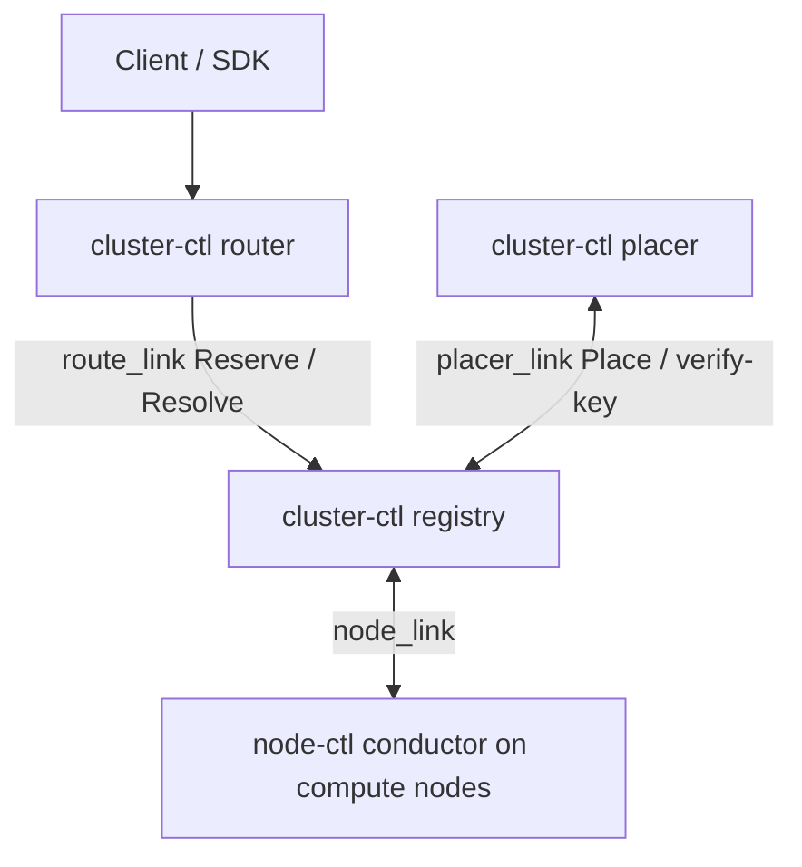
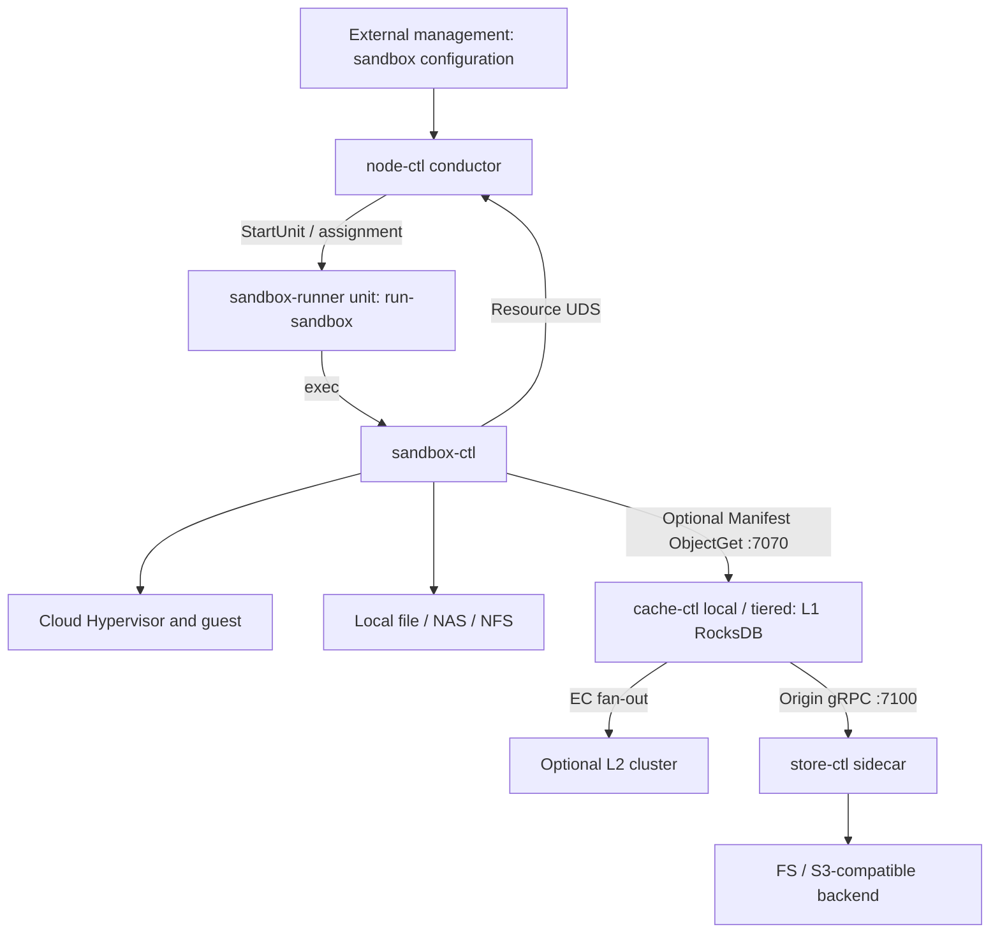
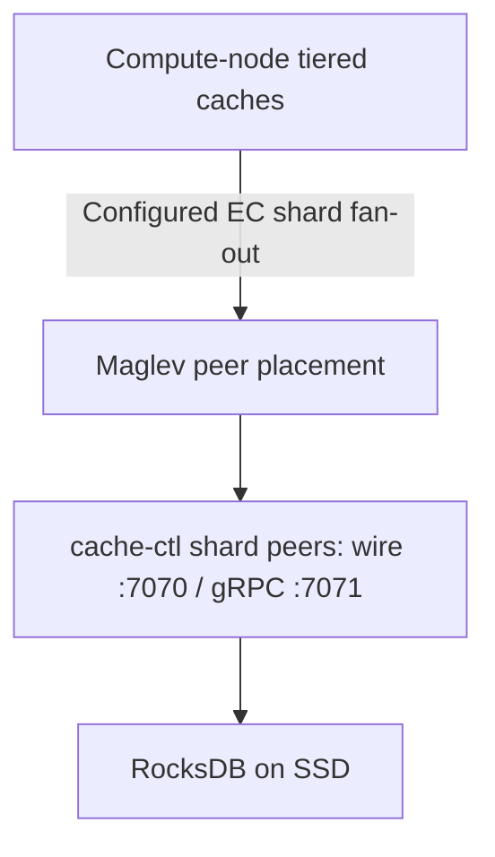
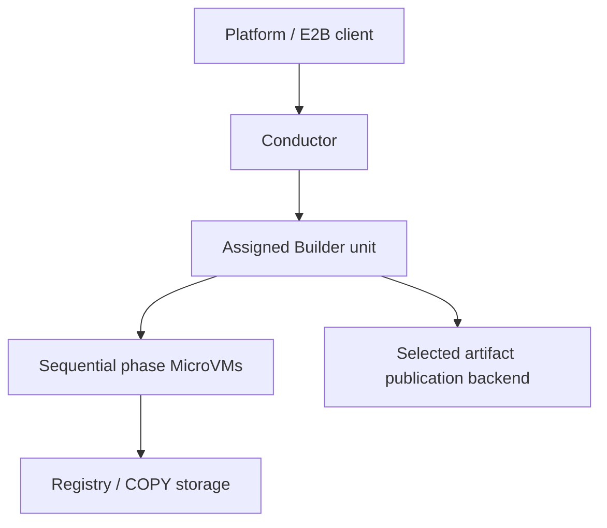

[English](deployment.md) | [简体中文](deployment_zh.md)

# 部署拓扑、装配与验收

面向准备安装生产节点或集群的运维者。先按[安装](installation_zh.md)取得匹配交付物；首次体验可走[快速开始](quickstart_zh.md)。Workbench 是测试和开发环境，生产部署独立运行。各组件维护完整 CLI、配置 schema 和内部行为，本篇维护进程位置、连接关系与依赖顺序。

## 角色概览

部署角色按数据路径和控制面拓扑选择.本地文件,共享文件存储与
Manifest/store/cache 可以分别使用,后两者不是单节点或集群部署的强制前提.

**节点与集群角色**

| 角色 | 职责 | 关键进程 |
|---|---|---|
| Compute Node | 承载 MicroVM 和节点资源控制;e2b 模板构建也在本节点的构建沙箱内进行([Build 部署](#build-部署)) | `node-ctl conductor serve`(含可选 `resource_listen`)、独立 Proxy master + workers、`sandbox-ctl × N`;Manifest 数据路径按需部署 `cache-ctl`,来源访问、发布或配置的写入准入需要 Store 时部署 `store-ctl` |
| Shared Storage | 为命名 `file://` location 提供跨节点原生文件访问 | 部署方提供的 NAS,NFS 或共享文件系统 |
| L2 Cache Cluster(可选) | 为 Manifest 路径提供分布式 EC 缓存,未部署时 cache 可以本地命中或直接回源 | `cache-ctl shard` |
| Cluster Control Plane(可选) | E2B 兼容多节点控制面:registry 维护执行态,router 提供统一入口,placer 导入 group 并放置;生命周期仍由 node 执行 | `cluster-ctl registry`,`cluster-ctl router`,`cluster-ctl placer` |

**外部共享资源**(由部署方运营,平台外)

| 资源 | 用途 |
|---|---|
| Local/NAS/NFS | 本地或跨节点原生文件工件,不要求转换为内容分片 |
| FS 或 S3-compatible store | Manifest 与 chunk 的远程持久化后端 |
| 平台管理面 | 沙箱实例调度、配置、租户管控、模板构建凭据(registry 拉取令牌 / 客户密钥);通过 **cluster 控制面**向 placer/provider 导入 sandbox-group 配置,或在单机部署中直接调用 `node-ctl` e2b API |
| 容器镜像仓库 | 租户镜像来源;构建沙箱内 `flatten-ctl` 按需拉取(OCI v1.1,支持 Referrers) |

## Compute Node

### 常驻进程

| 进程 | 角色 | 数量 | 启停 | 归属 |
|---|---|---|---|---|
| `node-ctl conductor serve` | 本机沙箱编排 + e2b 兼容控制面 + 节点级资源仲裁(`resource_listen`)+ node-link 集群接入客户端;经 run-id 模板单元 `sandbox-runner@<run-id>`/`sandbox-builder@<run-id>` 驱动 sandbox-ctl；数据入口由独立 Proxy 承载，Conductor 不直接提供数据面 | 单实例 | systemd | 平台内,[orchestrator/docs/node_zh.md](https://github.com/kuasar-sandbox/orchestrator/blob/main/docs/node_zh.md)(资源协议见 node-resource.md)|
| `node-ctl proxy serve`| proxy master 经 config-socket 订阅路由与 conductor-owned MMDS policy、绑定独立数据/MMDS入口并管理 worker;worker 用 mmap 读取固定路由,经 master 本机 RPC 查询可变 MMDS route/value/service,执行数据面鉴权、反代及 native exec gate | 1 master + `workers` 个 worker | systemd | 平台内,[orchestrator/docs/node-proxy_zh.md](https://github.com/kuasar-sandbox/orchestrator/blob/main/docs/node-proxy_zh.md) |
| `cache-ctl`(`mode: local|tiered`,可选)| Manifest 数据入口:节点本地 L1,可选 EC L2 和 store origin | 通常每个节点/所选配置一个实例;独立域可分实例 | systemd,使用 Manifest 路径时先于 node-ctl | 平台内,[docs/cache_zh.md](https://github.com/kuasar-sandbox/accelerator/blob/main/docs/cache_zh.md) |
| `store-ctl`(可选) | Manifest store 的节点侧 FS/S3-compatible 读写服务 | 通常每个节点/所选配置一个实例;独立域可分实例 | systemd,所选来源访问、发布或配置的写入准入使用 Store 时启动([Build 部署](#build-部署)) | 平台内,[docs/store_zh.md](https://github.com/kuasar-sandbox/accelerator/blob/main/docs/store_zh.md) |
| `sandbox-ctl`(`run`) | 单个沙箱的控制平面(类 `runc run`);非 daemon | 每沙箱一个 | 由 node-ctl 经 `sandbox-runner@<run-id>` 单元(`run-sandbox`)assignment 后启动 | 平台内,[Sandbox Runtime](https://github.com/kuasar-sandbox/sandboxer/blob/main/docs/runtime_zh.md) |
| `cloud-hypervisor` | VMM(patched);`sandbox-ctl` 子进程 | 每沙箱一个 | `sandbox-ctl` 派生 | 平台内,[VMM 契约](https://github.com/kuasar-sandbox/sandboxer/blob/main/docs/vmm_zh.md) |
| `connector-ctl vswitch start/serve` | 预先建立内核数据面、可信端口身份及按需 TAPFD 服务 | 每个所选 switch 一套数据面；serve 为可选常驻控制进程 | 在 Conductor 分配网络前启动并检查 ready；内核转发不依赖逐包用户态中继 | [网络运维](https://github.com/kuasar-sandbox/connector/blob/main/docs/vswitch-operations_zh.md) |
| `node-ctl telemetry serve`（可选） | 原生指标采集、导出与历史查询 | 由所选观测配置决定 | 使用该版本的 Collector、存储和查询配置独立部署 | [观测](https://github.com/kuasar-sandbox/orchestrator/blob/main/docs/observability_zh.md) |

### 端口与套接字

节点本地存储、缓存和控制服务应绑定 loopback 或 UDS;公开 API/数据入口和 L2 peer
监听是显式例外。下表地址是部署示例/惯例,实际值由所选配置确定:

| 进程 | 监听 | 协议 | 用途 |
|---|---|---|---|
| `store-ctl` | `127.0.0.1:7100` | gRPC | 为本机客户端提供持久对象读取、写入准入及写入；RPC schema 由 Store 规范维护|
| `store-ctl` | `127.0.0.1:7061` | gRPC health | 探针 |
| `cache-ctl tiered` | `127.0.0.1:7070` | wire(自定义二进制 TCP)| 数据面:`sandbox-ctl` / `manifest-ctl` 拉 chunk |
| `cache-ctl tiered` | `127.0.0.1:7071` | gRPC | health / `ping` / `info` |
| `node-ctl conductor serve(resource_listen)` | `/run/sandbox-resource.sock` | UDS,自定义协议 | 沙箱资源协议(`sandbox-ctl` 拨号目标)|
| `sandbox-ctl` | `<run_root>/sandboxes/<sid>/*.sock` | UDS | sandbox 内部:`ch.sock` / `blk{0,1}.sock` / `uffd.sock` / `ctl.sock` / `vsock.sock`(+ `_5000`);runtime PID file 标识 sandbox-ctl 进程；config-socket 上的 sandbox bootstrap/prepare 使用 `<run_root>/runners/<run-id>.pid` 鉴别父 RunID 进程;assignment/launch 参数经 config-socket 交接,不使用 SANDBOX_ARGS envfile|
| `node-ctl conductor serve` | `api.listen`,如 `:443` | 按拓扑使用 HTTPS/h2 或 HTTP/h2c | E2B 控制 API；独立 Proxy 提供单独的数据入口。集群内部 listener 约束见 [节点与管理面连接](#与节点--平台管理面的关系) |
| `node-ctl proxy serve`| `proxy.yaml.data_listen` | HTTPS/h2 或 h2c | **独立数据入口**;master 绑定 listener 并把 fd 交给 workers,native exec 使用 `service=exec` + `X-Access-Token` CONNECT |
| Proxy master/workers | conductor `mmds.listen`,默认 `127.0.0.1:19254` | HTTP/1.1 | vswitch `--mgmt-service` 的目标;master 从受信 Conductor policy 取得 listener 配置，绑定后将 FD 交给 workers |
| MMDS local service | `mmds.services.<name>.endpoint` | HTTP/1.1 over UDS | 服务注册表由 Conductor 持有；V1 使用 `unix://` absolute path，worker 经 master 获取允许的已解析 socket path |
| `node-ctl conductor serve` | `/run/sandbox/node-ctl.socket` | UDS,HTTP/h2c + framed JSON stream | config-socket(run/task/admin/plugin/api 五平面):启动器取 LaunchSpec/BuildSpec;admin 管 manifest key 与 sandbox MMDS value;external proxy/platform agent 经 plugin 平面注册并同步受控路由(SO_PEERCRED + `<id>.pid`/pidfile 鉴别)|

使用 tiered cache 时,EC 客户端通过节点对外网络拨号 L2 cluster 节点的 `7070`
端口（详见 [L2 Cache](#l2-cache-cluster)）；local cache 或直接 Store 路径不需要 L2。`node-ctl proxy serve` 启动一个 master 和配置数量的 workers，正常数据流量进入
`proxy.yaml.data_listen`,而控制面仍由 conductor 的 `api.listen` 承载。worker 使用自身
`proxy.yaml` 中必填的 `paths.run_root` 定位 `<run_root>/sandboxes/<NodeSandboxID>/ctl.sock`;该值是节点本地部署配置,
不经 routesync `Policy` 或共享内存路由视图传递。`proxy.yaml` 不配置 `mmds_listen` 或
`services`;conductor 的 trusted `proxy + route_wake + mmds` registration 是这两项的唯一
投影通道。其余本机进程均使用 loopback/UDS。
Conductor 经 **`sandbox-runner@<run-id>.service` 模板单元** 启动 sandbox-ctl。
Build 使用 **`sandbox-builder@<run-id>.service`**,同一时间最多一个阶段 MicroVM。
这些是默认 runner/builder 模板；实际按配置的各 pool 选择模板。Conductor 启动时生成并安装去重后的有效模板集合;将 `units.install` 设为 `false` 时由运维带外管理。
分配与进程生命周期见 [Node 进程管理](https://github.com/kuasar-sandbox/orchestrator/blob/main/docs/node_zh.md#systemd-pools);
Builder 任务准备、执行与发布见 [Build](https://github.com/kuasar-sandbox/orchestrator/blob/main/docs/node-build_zh.md)。

运维侧:`/run/sandbox/sandboxes/<sid>/ctl.sock` 除了承载 snapshot,也是 `sandbox-ctl exec
--sandbox-id <sid> -- CMD` 的本机入口。受管沙箱的本机客户端还须指定有效根,例如
`--run-root /run/sandbox/sandboxes`,才能定位同一 socket.远程调用不会直接暴露该 UDS:客户端先以
受支持的鉴权流程显式取得 ExecAccessToken,再访问已认证的 Proxy 入口;UDS 保留在本机。
[sandbox CLI](https://github.com/kuasar-sandbox/sandboxer/blob/main/docs/runtime_zh.md)
与 [Proxy 契约](https://github.com/kuasar-sandbox/orchestrator/blob/main/docs/node-proxy_zh.md)
统一维护 token 绑定、CONNECT headers 和帧校验。

<a id="resource-pool-deployment"></a>
### 资源池与执行池

开放准入前，同时配置资源记账与执行进程供给：

1. 在 `resource_listen.pools` 中定义资源池。调度 `capacity` 与运行时 `allocatable` 是不同预算；多池必须逐池声明净运行时内存，不能再叠加旧的物理内存与 host reservation 计算方式。
2. 将每个 Runner/Builder pool 绑定到一个 `resource_pool`，使用显式且稳定的名称。`size` 是空闲预热目标；可选 `capacity` 限制执行槽位，`priority` 决定选中资源池内的供给优先级。提高预热数量不会扩大资源预算。
3. 需要 NUMA 或 CPU 绑定时，先核对宿主拓扑及祖先 cgroup 权限，在预热前准备 systemd drop-in。采用 `units.install: false` 时，由自己的配置管理流程安装模板与 drop-in；reload systemd 不会迁移已经运行的进程。
4. 核验最终配置、`node-ctl resource pressure` 输出、VMM 实际 CPU/内存掩码，以及 Sandbox 和 Build 准入。开放流量前演练重启、Pause/Resume 和容量拒绝，并记录恢复涉及的源池与目标池。

[资源池契约](https://github.com/kuasar-sandbox/orchestrator/blob/main/docs/node-resource_zh.md#resource-pools)维护精确默认值、放置、持久化与压力规则。仍支持单个默认资源池，多池由部署方按需求选择。

### 持久化与运行时目录

以节点根 `/run/sandbox` 和 `/var/lib/sandbox` 为例,当前受管布局为:

| 路径 | 内容 |
|---|---|
| `/var/store/` | store-ctl FS 后端,可在本地盘或共享文件系统。 |
| `/var/cache/accel-l1/` | local/tiered L1 RocksDB,按工作集定容。 |
| `/run/sandbox/runners/<run-id>.pid` | Runner/build 执行身份 pidfile。 |
| `/run/sandbox/sandboxes/<sid>/` | socket、task pidfile/配置与临时 CH 元数据 staging (`snap-stage`/`snap-state`),位于 tmpfs。 |
| `/var/lib/sandbox/sandboxes/<sid>/` | 持久状态,包括 `<sid>.overlay.diff` 和 `checkpoint/`。 |
| `/run/sandbox/builds/<BuildID>/` | Build pidfile 与阶段运行目录/socket;目录名使用完整且已校验的 BuildID。 |
| `/var/lib/sandbox/builds/<BuildID>/checkpoint/` | Build 镜像与快照工件。 |
| `/var/lib/sandbox/node-ctl.db` | 默认 conductor SQLite 数据库 (`db_path`)。 |

`paths.run_root` 保存小型易失状态与 socket,`paths.base_root` 保存较大的磁盘数据。
资源控制器从 inventory/report 重建实时记账;已弃用的 `resource_listen.state_path`
被忽略,不再用资源 state.json 持久化。配置的 audit 输出是独立用途。

直接调用 sandbox-ctl 时,`--run-root`/`SANDBOX_RUN_ROOT` 与
`--base-root`/`SANDBOX_BASE_ROOT` 是所传根,PathID 是目录叶子。Conductor 对普通
沙箱传入派生的 `sandboxes/` 根,不能把 standalone `/run/sandbox/<sid>` 示例原样
用于受管部署。可写 overlay 应使用磁盘;快照输出由 `--output` 或 orchestrator 的
checkpoint 路径选择。权威实现见 [nodepath](https://github.com/kuasar-sandbox/orchestrator/blob/main/internal/nodepath/path.go)。

### 节点共享资源目录

平台维护按名称引用的共享输入,无需逐沙箱复制:

| 示例路径 | 用途 |
|---|---|
| `/opt/sandbox/kernel/<ver>/vmlinux` | 多内核版本并存,由 sandbox 配置选择。 |
| `/opt/sandbox/runtime/<ver>/sandbox-runtime.bundle` | 多 runtime 版本并存。 |
| `/opt/sandbox/overlay-templates/overlay-1g.ext4` | 预格式化 1 GiB ext4。 |
| `/opt/sandbox/overlay-templates/overlay-4g.ext4` | 预格式化 4 GiB ext4。 |
| `/opt/sandbox/overlay-templates/overlay-16g.ext4` | 预格式化 16 GiB ext4。 |

SANDBOX_CONFIG 示例:

```yaml
boot:
  kernel:  file:///opt/sandbox/kernel/6.1.169-sandbox/vmlinux
  runtime: file:///opt/sandbox/runtime/v1/sandbox-runtime.bundle
  root:
    overlay:
      # 省略 diff 时使用有效 base root 与 PathID,见 持久化与运行时目录。
      diff_template: file:///opt/sandbox/overlay-templates/overlay-1g.ext4
```

**初始化约定**:runtime/kernel 文件是共享输入,不逐沙箱复制。Runtime 的
virtio-pmem/DAX 可经 host page cache 共享不可变 backing 页;共用一个 kernel 文件
不表示所有 Guest 共用一份驻留内核工作集,每个 Guest 有独立执行状态。

Overlay 是沙箱私有可写盘。省略 diff 时,sandbox-ctl 在有效 base 磁盘目录下创建并
拥有新 diff。diff_template 用模板的逻辑稀疏内容初始化,启用 active-diff 加密时按
所选策略写入,不要求 node-ctl 预先 cp。显式路径已有非空 diff 时按格式/策略打开,
所有权仍属于调用者;显式路径不存在也可按已配置的 template/base 初始化。已有空 diff
会被拒绝。见 [PrepareDiff](https://github.com/kuasar-sandbox/sandboxer/blob/main/pkg/sandbox/overlaydiff.go)
和 [active-diff 存储](https://github.com/kuasar-sandbox/sandboxer/blob/main/docs/block-storage_zh.md)。

### per-sandbox 配置下发

Conductor 管理节点记录与已校验的启动策略；runner 和 builder 经节点本地 config socket 获取精确任务。RunRoot/BaseRoot 与安装的 unit 模板必须保持一致。宿主 root 与 daemon UID 属于信任域，Guest 不得访问该 socket。

生成的 sandbox 与 Build phase YAML 使用 `0600` 权限,仍须按内容保护:用户 launch env 可能含敏感数据。
凭据更新只影响之后插入的记录,不会重新绑定已复制进持久 sandbox/build 记录的凭据;完整生命周期由节点凭据契约维护。

[节点规范](https://github.com/kuasar-sandbox/orchestrator/blob/main/docs/node_zh.md) 统一定义鉴权、分配与 bootstrap/finalize schema；[Build 规范](https://github.com/kuasar-sandbox/orchestrator/blob/main/docs/node-build_zh.md) 定义构建任务准备和执行。不得将内部 socket 暴露为公共 API。


MMDS、公开入口和集群内部网络的保护要求统一见[安全边界](security_zh.md)。

## L2 Cache Cluster

L2 是 Manifest 数据路径的可选加速层.部署可以只使用 local cache + store origin,
也可以按工作集和故障域部署 shard 集群.它不参与本地文件或命名共享文件读取.

### 集群规格

- **规模**:按工作集、命中率目标、SSD、网络与故障域实测决定。
- **编码**:配置 data_shards: 4 / parity_shards: 1 且 peer 充足时,每 chunk 编成 5 片。
- **放置**:Maglev 按 chunk hash 确定有序 peer set,通过 LocateN(key, 5)/EC router 的
  peer 选择路径完成。真正 RS 4+1 至少需 5 peer;初始构建会将超过 peer 数的 scheme
  clamp 到可用规模,小池不能仍称为 4+1。应核验有效 scheme 与启动日志。扩容不替换
  placement 算法,见 [Cache 放置](https://github.com/kuasar-sandbox/accelerator/blob/main/docs/cache_zh.md)。
- **资源**:SSD、RocksDB BlockCache (mem_ratio) 与网络按部署测量选择。
- **隔离**:镜像 chunk / 快照 chunk 可用不同 RocksDB path 和成员表分开部署。
- **持久化**:如 /mnt/ssd/accel-l2 下的 RocksDB 可在 daemon 重启后保留缓存,但缓存
  是可重建数据,这不保证所有崩溃、存储故障或未同步写入都不丢数据。

### 端口

| 进程 | 监听 | 协议 | 用途 |
|---|---|---|---|
| `cache-ctl shard` | `0.0.0.0:7070` | wire | shard PUT/GET(由 compute node 上 tiered cache-ctl 发起)|
| `cache-ctl shard` | `0.0.0.0:7071` | gRPC | health / `info` |

`shard` 模式既不访问 L3 也不持有任何 origin 凭据,纯 KV——这是它能水平扩展、
彼此对等无主的前提。

### 成员变更

各 compute node 的 tiered YAML 配置 `tiers[].cluster.peers`。增减 peer 是
compute 侧**配置变更 + SIGHUP**,重建 Maglev 表。受影响的 key 取决于变更前后的
成员表,不能承诺普遍且精确的 1/M 迁移比例。存活 peer 按返回帧内记录的 shard index
继续提供既有 shard。

**一次只变更一个 peer**。同时更换两个或更多 peer 可能超过 4+1 的单 parity 容忍度,
使相关 key 发生 L2 miss 并回源。确认收敛/命中后再改下一个 peer;此规程是降低风险,
不是永不 miss 的保证。Shard 自身仍是 KV 服务,无需维护成员表。

## 外部持久化与管理资源

### 存储后端

本地和命名共享文件工件由文件系统直接承载.Manifest 路径的 `store-ctl` 支持
FS 和 S3-compatible 后端:FS root 可以位于本地盘或共享文件系统,S3-compatible
后端可以使用一个或多个 bucket.后端的容量,故障域和共享范围由部署方选择.
store 内部路径由 `store-ctl` 维护,详见 [docs/store_zh.md](https://github.com/kuasar-sandbox/accelerator/blob/main/docs/store_zh.md).

S3-compatible 后端使用部署配置或 SDK 默认凭据链.凭据只进入可信 host 服务,
不写入 Guest 或文档示例.每个节点可以运行本地 `store-ctl` sidecar 并连接同一
持久化后端;FS backend 也可以直接使用节点本地或共享目录.

### 外部管理面接口

region 级、独立运营,平台外。与平台的接口:

- 多节点部署:平台管理面向 `cluster-ctl placer` 的 provider/importer 侧导入
  sandbox-group 配置、selector、客户密钥引用和模板构建凭据。
- 单节点部署:平台管理面可直接调用 `node-ctl` e2b API,并按 [实例配置下发](#per-sandbox-配置下发) 的配置契约
  提供 per-sandbox 启动配置;使用 Manifest 路径时再提供对应内容保护配置.
- 节点侧桥接进程若由外部系统提供,不属于本发布件,也不改变本页列出的进程、
  配置和启动依赖。

构建在 compute 节点的构建沙箱内进行([Build 部署](#build-部署)),无独立展平管理面/数据面池。

## Build 部署

Build 在计算节点上由 Conductor 分配的 `sandbox-builder@<run-id>` unit 执行。Builder 按目标顺序运行所需沙箱阶段，同一时间最多保留一个阶段 MicroVM。模板 API、目标解析、Build 资源准入、精确任务消息、steps、发布与恢复统一见 [node-build_zh.md](https://github.com/kuasar-sandbox/orchestrator/blob/main/docs/node-build_zh.md)。

部署时需提供 Guest Runtime/Kernel 与展平工具、导入镜像时 Guest 可访问的 OCI registry，以及所选持久化输出路径。镜像发布使用配置的 Store 或命名文件 carrier；原生文件快照并不要求转换到对象存储。COPY 上下文需要配置的对象存储与预签名上传能力，不经 Conductor 代理公开上传字节。

Manifest Store 发布需要 Store。来源读取依赖所选 Cache/Store 或 file/Bundle 路径。
命名 location 的 Bundle 发布在来源图完全可由 file/Bundle 解析且离线写入准入有效时,可以不运行 `store-ctl`。
若已配置 Store endpoint,仍须通过其写入准入,失败不得回退到离线模式。
[Manifest 准入契约](https://github.com/kuasar-sandbox/accelerator/blob/main/docs/transfer_zh.md) 与 Build 发布规则共同确定所选依赖。

Registry 拉取和工件发布使用独立作用域凭据；宿主内容保护材料不得进入 Guest 工作负载。按 Build 契约配置逐 Build 的 registry 信任、节点路径、builder unit 与聚合资源上限，不能仅凭存在 `startCmd` 就假定固定三阶段。Conductor、必要存储服务和 Guest 可达网络就绪后再接纳构建。

## Cluster Control Plane (cluster-ctl)

多 compute 节点部署由三个角色组成 cluster 层:**registry** 是状态集群与节点通道枢纽,
**router** 是 E2B 控制/数据公共入口,**placer** 负责 group provider/importer 与放置调度。
路由、激活和鉴权由各自契约维护,见 [cluster_zh.md](https://github.com/kuasar-sandbox/orchestrator/blob/main/docs/cluster_zh.md)。
单 compute 节点独立直供 E2B SDK 时不需要 cluster 层。



### 进程

| 进程 | 角色 | 数量 | 启停 | 归属 |
|---|---|---|---|---|
| `cluster-ctl registry` | registry 自聚簇成员;复制 `route_link` / `node_link` / `node_list` / `placer_link` 执行态,承载 node 长连接和 route/node owner RPC | 1 或 N 副本;每个 group/node 由 LocateN 选 owner set | systemd | 平台内,`cluster.md` |
| `cluster-ctl router` | E2B 兼容统一入口（`api.<domain>` 控制面与数据面）及近期 route cache；按操作区分的解析、激活、鉴权和转发规则由 Router 规范维护 | N 副本(LB 后,无状态)| systemd | 平台内,`cluster-router.md` |
| `cluster-ctl placer` | group provider/importer、WATCH_LIST 消费方与放置调度器;向 registry 提供 PlaceSandbox / PlaceBuild / verify-key | N 副本;按 placer memberlist ready 视图和 group 确定性 failover | systemd | 平台内,`cluster-placer.md` |

小规模可三角色同机共置;大规模按 registry 成员表、router 入口副本和 placer 副本分别扩展。

### 端口

| 进程 | 监听 | 协议 | 用途 |
|---|---|---|---|
| `cluster-ctl router` | `:443` | HTTPS/h2 | **对外** e2b 控制面 + 数据面入口(机群唯一北向面)|
| `cluster-ctl registry` | `member.listen`,如 `:7700` | JSONRPC over HTTP/h2c 或 HTTPS | 统一控制面;按 path 承载 `/node-link/*`、`/route-link/*`、`/placer-link/*`、`/cluster/membership`、`/internal/registry-member/*`、`/internal/memberlist/*` |
| `cluster-ctl registry` | `node_link.listen`(可选) | JSONRPC over HTTP/h2c 或 HTTPS | 可选独立 node 长连接监听;为空时复用 `member.listen` |
| `cluster-ctl placer` | `placer.listen`,如 `:7800` | JSONRPC over HTTP/h2c 或 HTTPS | placer Place / verify-key API;memberlist HTTP transport 复用同一监听 |

### 与节点 / 平台管理面的关系

节点与 Registry 建立已认证的 node-link 会话，并显式通告 API 与数据端点。Router 向 Registry 获取按 group 分区的状态，再向选定节点转发控制/数据请求。Placer 从所配置 Provider 导入 group 并提出放置建议，节点准入仍是资源确认方。

当前 Router→node 使用明文 HTTP/CONNECT：`APIEndpoint` 与 `DataEndpoint` 必须登记两个不同、可达的内部明文 listener，不能填入启用 TLS 的节点 listener。应保护该内部网络，并在 Router 或其前置负载均衡器终止公网入口 TLS。Node-link 独立使用其配置的 mTLS。独立部署可以在两个不同的节点 API/data 入口终止 TLS，不能把这种 listener 配置直接照搬到集群注册。

按入口和发现配置部署 Router/Placer，保证 Registry bootstrap 与通告端点可达。[Registry 协议](https://github.com/kuasar-sandbox/orchestrator/blob/main/docs/cluster_zh.md)、[Router 行为](https://github.com/kuasar-sandbox/orchestrator/blob/main/docs/cluster_zh.md#client-access) 与 [Placer 契约](https://github.com/kuasar-sandbox/orchestrator/blob/main/docs/cluster_zh.md#groups-and-placement) 分别维护 Resolve/Reserve schema、缓存、激活和重试语义；部署指南不复制这些状态机。


## 全景拓扑

以下分为进程/数据、L2 与构建三种关系视图。外部端点代表其他角色或 region 级服务。

### Compute Node



### L2 Cache Cluster



有效 RS 4+1 每个 chunk 选择五个 peer。Origin 凭据与访问留在 compute node 的 store-ctl,不交给 shard。

### Image Build (in-sandbox, on Compute Node)



此图表达部署关系，不定义固定阶段数量或发布算法；完整规则见 [Build 执行与发布](https://github.com/kuasar-sandbox/orchestrator/blob/main/docs/node-build_zh.md#execution-and-publication)。

## 启停依赖

### 启动顺序

在下面的服务顺序之前，验证同一交付组合中的 sandbox-ctl、Cloud Hypervisor、kernel 和 runtime bundle 均可读且架构匹配。按[网络运维](https://github.com/kuasar-sandbox/connector/blob/main/docs/vswitch-operations_zh.md)预先启动 switch，检查 TAPFD/管理服务/网关路径。Conductor 负责端口分配，不替代宿主 switch 初始化。


**外部依赖(按部署选择)**

1. 本地/共享文件路径已挂载并可访问;所选来源与发布后端已就绪([Build 部署](#build-部署)),包括已配置的 FS/S3-compatible Store

**L2 Cache Cluster(可选,在使用它的 compute 之前)**

2. 配置的 `cache-ctl shard` 成员启动并健康
3. 集群成员清单(`tiers[].cluster.peers`)落到 compute node 配置仓

**Compute Node(每节点独立)**

4. 所选来源访问、发布或配置的写入准入使用 Store 时启动 `store-ctl`,确认 active
   generation 已 init 且 gRPC 健康
5. 使用 cache 时启动 `cache-ctl local|tiered`;tiered 模式确认 L2 peer 和 store
   origin 可达
6. 启动 Conductor 及配置的 resource_listen，完成节点恢复/对账；启动独立 Proxy master/workers，核验受信 registration、监听与路由同步。此后才通过 standalone E2B 或配置的 Registry/Router 入口开放沙箱准入。每个新 Create 都必须通过 Proxy route barrier，控制 API 已监听本身不代表已就绪。

注：`cache-ctl tiered` 启动不要求 L2 全员在线。clean miss 可下穿，后端或协议错误则保持 Cache 契约的显式错误语义，不能把任意失败当作 miss(详见 [docs/cache_zh.md](https://github.com/kuasar-sandbox/accelerator/blob/main/docs/cache_zh.md) 错误模型)。**写**路径
(`manifest-ctl store` 直连 `store-ctl`)在所选持久化后端 / store-ctl 不可达时会失败.

Build 复用 Conductor;待 Conductor、所选来源/发布后端及配置的 Store 写入准入 endpoint
全部就绪后,再接纳构建([Build 部署](#build-部署))。

### 关闭顺序(自顶向下)

1. 平台管理面 / cluster / 客户端停止向该节点接纳新的沙箱和 Build 工作
2. 排空存量工作,明确等待退出或所请求的 snapshot 完成后再停 conductor。SQLite
   保存已记录的生命周期状态;资源记账在重启后重建,不持久化资源 state.json。
   单独发送 SIGTERM 不是为所有 Guest 自动打快照的指令
3. 若部署 cache-ctl,则 SIGTERM,等待正常在途请求处理和 RocksDB 关闭完成
4. 若部署 `store-ctl`,则最后停止该服务

L2 cluster 的关闭与 compute node 关闭无强序——每个 compute node 的 `cache-ctl
tiered` 按 Cache 错误/回退契约处理 L2 不可达，不把任意错误自动当作 clean miss。

## 部署规模示例

### 开发 / PoC(单机)

```
单机:  store-ctl       (fs backend, /var/store)
       cache-ctl       (mode: local,无 L2)
       sandbox-ctl × N (node-ctl 可省,手工 run)
```

无 L2 cluster,无远程对象存储,无独立资源控制器(资源仲裁随 `node-ctl conductor serve` 内置,`resource_listen`
未配则静态 cgroup);`manifest-ctl` 走本机 `store-ctl` + `cache-ctl`。对应 [docs/cache_zh.md](https://github.com/kuasar-sandbox/accelerator/blob/main/docs/cache_zh.md)
中的 local 模式。**单机直供 e2b SDK,无需 cluster 层(`node-ctl conductor serve` 即北向面)**。

### 生产单 AZ

```
Compute:           scale by peak working set, active ratio, restore cost, and safety margin
Storage:           Local NVMe / NAS / NFS / FS or S3-compatible store
Optional cache:    local cache or an L2 shard cluster sized by hit rate and failure domain
Control plane:     node-ctl standalone or registry + router + placer
```

每个 compute 节点运行 `node-ctl` 和当前沙箱对应的 `sandbox-ctl`;使用 Manifest
数据路径时再部署 `store-ctl` 与可选 `cache-ctl`.节点数量,单节点并发和 cache
容量必须用目标版本,硬件,沙箱规格与 workload 实测,不能由架构图中的固定值推导.
Cluster Control Plane 由 registry 自聚簇,LB 后的 router 和 placer 组成,副本数按
可用性与负载选择.

### 多 AZ

每个 AZ 可以独立运行 compute 和可选 L2 cache,并按故障域选择共享文件系统或
S3-compatible store.使用 tiered cache 时,compute 节点通常优先连接本 AZ peer,
减少跨 AZ 热路径流量.是否跨 AZ 共享内容由内容密钥,安全域和后端配置共同决定,
不能仅因内容相同自动跨租户或跨故障域共享.

## 配置入口

完整字段与默认值由组件维护；本表帮助定位装配时必须一致的配置。

| 入口 | 配置位置或命令 | 关注点与权威规范 |
| --- | --- | --- |
| store-ctl | `--config <path>` | [持久后端、generation 与服务监听](https://github.com/kuasar-sandbox/accelerator/blob/main/docs/store_zh.md) |
| cache-ctl | `--config <path>` | [local/shard/tiered 与后端选择](https://github.com/kuasar-sandbox/accelerator/blob/main/docs/cache_zh.md) |
| Conductor | `/etc/node-ctl/conductor.yaml` | [进程装配与共享配置加载](https://github.com/kuasar-sandbox/orchestrator/blob/main/docs/node_zh.md) |
| Proxy | `/etc/node-ctl/proxy.yaml` | [数据入口、worker、MMDS 受信投影](https://github.com/kuasar-sandbox/orchestrator/blob/main/docs/node-proxy_zh.md) |
| Node resources | `resource_listen` | [准入、grant 和水位](https://github.com/kuasar-sandbox/orchestrator/blob/main/docs/node-resource_zh.md) |
| Build | `builder` | [阶段资源、输入与发布依赖](https://github.com/kuasar-sandbox/orchestrator/blob/main/docs/node-build_zh.md) |
| Registry / Router / Placer | `--config <path>` | [角色配置、Group/provider 与路由](https://github.com/kuasar-sandbox/orchestrator/blob/main/docs/cluster_zh.md) |
| Telemetry | `node-ctl telemetry` | [采集、导出和查询服务的选定配置](https://github.com/kuasar-sandbox/orchestrator/blob/main/docs/observability_zh.md) |
| sandbox-ctl | `--config <path>` / `SANDBOX_CONFIG` | [单实例声明、默认值与覆盖](https://github.com/kuasar-sandbox/sandboxer/blob/main/docs/configuration_zh.md) |
| manifest-ctl | `--manifest-config <path>` / `MANIFEST_CONFIG` | [通用数据处理及 Store/Cache 连接](https://github.com/kuasar-sandbox/accelerator/blob/main/docs/transfer_zh.md) |
| flatten-ctl | `--config` / `FLATTEN_CONFIG` | [镜像输入输出、registry 凭据与上传](https://github.com/kuasar-sandbox/guest-runtime/blob/main/docs/flatten-cli_zh.md) |
| connector-ctl | `vswitch start` / `serve` | [宿主网络、管理服务和 TAPFD 提供端](https://github.com/kuasar-sandbox/connector/blob/main/docs/vswitch-operations_zh.md) |

Conductor 配置拥有 MMDS 监听、路由准入策略与本地服务注册。具体沙箱/Build 路由由受支持请求提交，经 Conductor 校验后向 Proxy 投影。原生文件数据路径不要求配置 Manifest/Store/Cache；按实际来源与发布路径选择依赖。

<a id="production-start"></a>
## 生产参考起点与上线验证

假设服务一个小团队、有测量后的有限并发、一台原生架构 KVM 节点、部署方管理的
网络网关，且应用允许节点不可用。先使用现有独立 Conductor/Proxy、生产 TLS/API
凭据、本地不可变工件和明确备份的 checkpoint 目录。这是**单一故障域**，不是
HA 或自动灾备。前面的清单与依赖章节已给出进程、端口、目录和启动顺序，不要因此部署所有可选服务。
工作负载接入见[自己的首个应用](templates_zh.md#first-application)。

| 选择 | 何时使用 | 新增运维责任 |
|---|---|---|
| 本地文件 | 工件放得下，允许节点亲和与重建时间 | 磁盘容量、备份、不可变 runtime/kernel 保留；节点损失可能丢唯一副本。 |
| 命名共享文件位置 | 多个合格节点需读取相同原生工件 | 一致 location 名、挂载/访问/身份检查、共享文件系统可用性/延迟和备份。可达不等于可恢复（[恢复资格](upgrading_zh.md#restore-eligibility)）。 |
| Manifest + 持久 Store | 需要远端持久化、大规模分发或对象按需读取 | 客户密钥、generation、完整父链、完整性和源站可用性；引入本地 cache 需内存/磁盘预算。 |
| 可选 L2 | 实测重复远端 miss/工作集分布值得增加缓存层 | peer 故障域、成员变更、shard 资源及有效 EC 几何。L2 是可重建加速层，不是持久工件副本。 |
| Registry/Router/Placer 集群 | 需要跨节点放置和公共入口 | provider/凭据持久化、Registry 所有权、内部私有 listener、准入与恢复验证；不会令不兼容节点可恢复。 |

开放准入前固定 aggregate/checksum，使用配套原生产物和打包文档，检查有效配置，
执行真实 build/create/命令/文件/pause/resume/kill。使用实际网关 allow/deny
策略及冷工件读取复验。如所选版本包含 [Telemetry](https://github.com/kuasar-sandbox/orchestrator/blob/main/docs/observability_zh.md#telemetry-release-scope)，
独立验证 exporter/query。源码支持 `TARGET_ARCH` 不证明交叉构建/仿真或历史
Release 资产；遵循[下载选择](installation_zh.md)和[原生 Workbench 构建](../workbench/README_zh.md)。
未合入版本选择、下载验证器或 WSL 提案不改变所选发布契约。

在预发布故障演练中只停止自有进程、隔离测试源，观察 readiness、首因、停止准入、
工件保留与恢复，测量 [容量验收](performance_zh.md#capacity-example) 容量场景。全部必需检查通过才开放准入；失败则保留上次
合格配置并停止新放置。测试结束通过 owner kill，不删共享文件。验收记录包括
准确 Release、负载、限制、失败/跳过探针及回滚输入。

## 后续运维

[日常运维与保留](operations_zh.md)、[版本升级与恢复资格](upgrading_zh.md)和[容量验收](performance_zh.md#capacity-example)分别维护完整任务；本篇只维护组件装配与上线验收。
